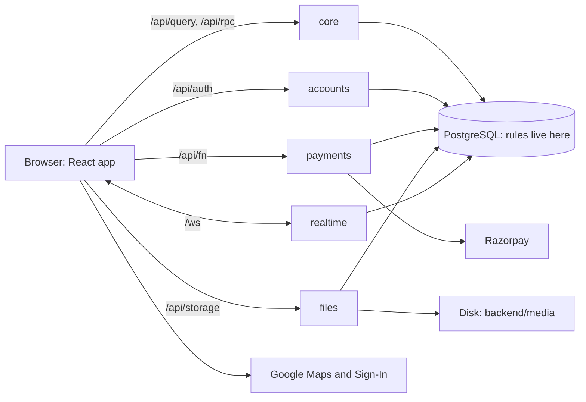
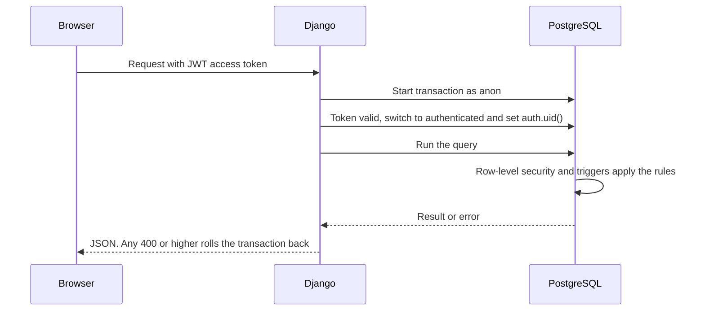
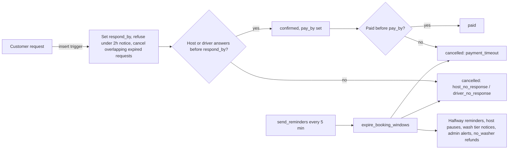

# Architecture

Synchoo is a marketplace for vehicle rentals, driver hire, car pooling and vehicle washes. It has a shared wallet and takes payments in rupees through Razorpay.

## The big picture

| Part | Folder | Technology | Local port |
| --- | --- | --- | --- |
| Frontend | `frontend/` | React 19, Vite, TanStack Router, Tailwind, shadcn/ui | 8080 |
| Backend | `backend/` | Django 5.2, Django REST framework, Channels | 8000 |
| Database | `backend/sql/schema.sql` plus `backend/core/migrations/` | PostgreSQL 17 | 5432 |

## The most important idea: rules live in the database

Prices, refunds, wallet entries, status changes and permissions are enforced by PostgreSQL triggers, functions and row-level security.

- The browser can show a price preview, but the database calculates the real price when the booking is saved.
- Django does not repeat these rules. It passes requests through as the right database role.
- If a rule changes, change it in a **new migration**. Recent pull requests also copy the change into `backend/sql/schema.sql`. A fresh database loads that file in migration `0001` and then runs every later migration again, so each migration must be safe to re-run (`CREATE OR REPLACE`, `IF NOT EXISTS`).
- Deadlines (when a host must answer, when a customer must pay) are also database rules. See [Booking windows](#booking-windows-and-dispatch) below.

## How one request works

| Database role | Used for |
| --- | --- |
| `anon` | Signed-out visitors |
| `authenticated` | Signed-in users, limited by row-level security |
| `service_role` | Server actions that write locked columns, such as payment status |
| Owner | Django's own tables only, through `as_owner()`. It bypasses row-level security, so never use it for user requests |

## Backend apps

| App | Responsibility | Main files |
| --- | --- | --- |
| `core` | Turns the frontend's query chain into safe SQL, runs database functions, switches roles | `query.py`, `views.py`, `db.py`, `auth.py`, `middleware.py` |
| `accounts` | Sign-up, sign-in, token refresh, Google sign-in, password reset | `accounts/views.py`, `accounts/models.py` |
| `payments` | Razorpay orders and signature checks, payment-window checks, refunds for late payments, wallet top-up, QR lookup, handover, inspection, membership | `payments/views.py`, `payments/trip_window.py` |
| `files` | Uploads and signed links for storage buckets | `files/views.py` |
| `realtime` | One WebSocket that pushes table changes to signed-in users | `realtime/consumers.py` |

## API surface

| Route | Purpose |
| --- | --- |
| `POST /api/query/` | Read and write tables as the signed-in user. Returns at most 1000 rows |
| `POST /api/rpc/<name>/` | Call a database function, such as `cancel_booking` |
| `POST /api/fn/<name>/` | Call a server action, such as `createRazorpayOrder` |
| `/api/auth/*` | Sign-up, sign-in, refresh, sign-out, current user, Google, password reset |
| `/api/storage/<bucket>/*` | Upload, remove and sign files |
| `/api/storage/public/<bucket>/<path>` | Read a file from a public bucket |
| `/api/storage/file/<token>` | Read a file through a signed link |
| `ws://.../ws/` | Live updates |

Database errors return HTTP 400 as `{message, code, details, hint}`.

## Frontend structure

| Path | What it holds |
| --- | --- |
| `src/routes/` | One file per page. Pages under `_authenticated/` redirect to `/auth` when signed out |
| `src/lib/api.ts` | The only module that talks to the backend |
| `src/lib/actions.ts` | Wrappers for `/api/fn/*`. These throw on failure |
| `src/lib/charges.ts`, `format.ts`, `driver-pricing.ts` | Price previews that mirror the database |
| `src/lib/trip-window.ts` | Check-in rules, mirrored by `backend/payments/trip_window.py` |
| `src/lib/pool-match.ts` | Route matching for car pooling |
| `src/components/ui/` | shadcn/ui building blocks |
| `src/components/admin/` | Admin console tabs |

`src/routeTree.gen.ts` is generated, so don't edit it.

## Main data areas

| Area | Tables |
| --- | --- |
| People and roles | `profiles`, `user_roles`, `vendors`, `drivers`, `cleaners`, `wash_centers`, plus public copies `public_profiles`, `public_vendors`, `public_drivers` |
| Rentals | `vehicles`, `vehicle_images`, `availability_blocks`, `bookings`, `booking_extensions`, `booking_locations`, `messages`, `reviews`, `vehicle_maintenance` |
| Driver hire | `driver_bookings`, `driver_reviews` |
| Car pooling | `pool_trips`, `pool_requests`, `pool_ratings` |
| Vehicle wash | `wash_services`, `wash_bookings`, `wash_reviews`, `wash_job_releases`, `wash_vendors`, `wash_center_packages`, `wash_center_staff` |
| Money | `wallets`, `wallet_transactions`, `wallet_topups`, `withdrawals`, `coupons`, `platform_settings` |
| Trust and support | `disputes`, `incidents`, `trusted_contacts`, `user_reports`, `support_tickets`, `ticket_messages`, `notifications` |
| Configuration | `cities`, `category_rules` |

## User roles

| Role | How someone gets it | Main pages |
| --- | --- | --- |
| Customer | Automatically at sign-up | `/browse`, `/bookings`, `/hires`, `/washes`, `/wallet` |
| Host (`vendor`) | Creates a host profile | `/vendor` |
| Driver | Submits a driver profile, then admin approves | `/driver-dashboard` |
| Cleaner | Submits a cleaner profile, then admin approves | `/cleaner-dashboard` |
| Wash center | Submits a center profile, then admin approves | `/wash-center-dashboard` |
| Admin | Added directly in the database | `/admin` |

One account can hold several roles.

## Storage buckets

| Bucket | Public | Holds |
| --- | --- | --- |
| `vehicle-images` | Yes | Vehicle photos |
| `avatars` | Yes | Profile pictures |
| `kyc-docs` | No | Host identity documents |
| `verification-docs` | No | Customer licences, vehicle and driver documents, chat images |
| `trip-photos` | No | Inspection photos |

## Live updates

A database trigger announces each change. The WebSocket server then re-reads the row as each connected user, so people only receive rows they are allowed to see. Chat, notifications, live location and wallet balance use this.

## Scheduled job

`python manage.py send_reminders` creates trip and licence-expiry reminders, then calls `expire_booking_windows()`. **Run it every 5 minutes** (cron on a server, Windows Task Scheduler locally). Without it, nobody is reminded or told about expiries, and unclaimed washes are never cancelled or refunded.

## Booking windows and dispatch

Built in #40, #42, #43 and #44 (migrations 0030 and 0032 to 0034). Pooling and corporate are not built yet. The rules are in [Business rules §17](03-business-rules.md#17-booking-windows), and the design is in [booking-windows/suggested-approach.md](booking-windows/suggested-approach.md).

| Piece | Where |
| --- | --- |
| Deadline formula | `booking_deadline()` |
| Stored deadlines | `respond_by`, `pay_by`, `confirmed_at`, `respond_reminded_at`, `pay_reminded_at` on `bookings` and `driver_bookings`. `pay_by`, `tier_notified`, `admin_alerted_at` on `wash_bookings` |
| Approval and payment guards | `prevent_booking_conflict`, `prevent_driver_booking_conflict`, `trg_zz_booking_windows`, `trg_zz_driver_booking_windows`, `wallet_pay_*`. The `zz` triggers run after the update-scope triggers because Postgres runs BEFORE triggers in name order |
| Razorpay checks | `create_*_razorpay_order` refuse with under 5 minutes left. `verify_*` and the webhook refund late payments to the wallet |
| Host accountability | `vehicles.instant_book`, `vendors.listings_paused_at`, `host_response_stats()`, `reactivate_vendor_listings()` |
| Driver alternatives | `similar_drivers()`, `trg_cancel_linked_driver_hire` |
| Wash dispatch | `cleaners.base_lat`, `base_lng`, `radius_km`, `haversine_km()`, `can_cleaner_see_wash_job()`, `wash_job_board()`, `claim_wash_job()`, `release_wash_job()`, `admin_assign_wash_cleaner()` |
| Dashboard totals (#41) | `host_dashboard_stats()`, `driver_dashboard_stats()`, `wash_center_dashboard_stats()` |

The frontend only displays deadlines (`/bookings`, `/hires`, `/washes`, `/vendor`, `/driver-dashboard`, `/cleaner-dashboard`) and never recomputes them. The cleaner job board refreshes live over the WebSocket.

## How to change something safely

| Change | What to do |
| --- | --- |
| Business rule or schema | Add a re-runnable `RunSQL` migration in `backend/core/migrations/` with the next number (latest: `0034_wash_booking_dispatch`). Update the schema counts in `backend/tests/test_db_roles.py`, `frontend/src/tests/harness/fake-backend.ts` and the flow tests |
| Two branches both add a migration | Renumber one so the chain has a single latest migration. `test_core_migration_graph_has_one_leaf` fails otherwise |
| Price calculation | Update the database function and its frontend preview together |
| Check-in window | Update `trip-window.ts` and `trip_window.py` together |
| New server action | Add it to `FUNCTIONS` in `payments/views.py` and to `src/lib/actions.ts` |
| New page | Add a file in `src/routes/`. The route tree regenerates itself |
