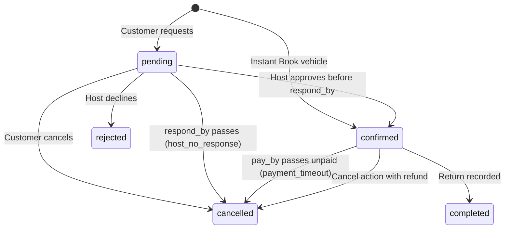
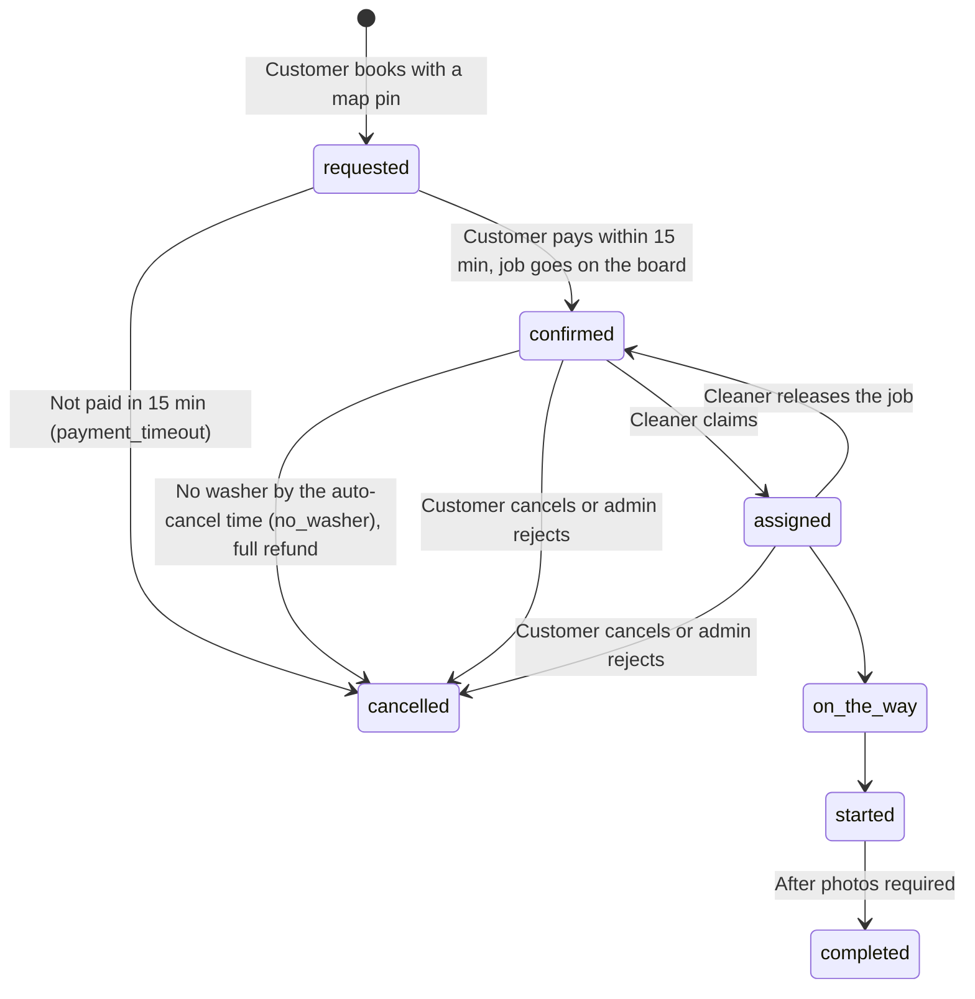

# Business rules

This is the reference for every calculation, status and fallback. When the app disagrees with this doc, check [Launch gaps](04-launch-gaps.md), then raise a bug.

All examples use the default fees: service fee 5%, GST 18%, commission 10%.

## 1. Charges on every booking

The database function `compute_charges` applies these formulas to rentals, driver hire and washes.

| Item | Formula |
| --- | --- |
| Discount | Percent coupon: `base × percent ÷ 100`. Amount coupon: the fixed amount. Never more than base |
| Service fee | `(base − discount) × 5%` |
| GST on fee | `service fee × 18%` |
| Commission | `base × 10%`, calculated before the discount |
| GST on commission | `commission × 18%` |
| **Provider earning** | `base − commission − GST on commission` |
| **Customer total** | `base − discount + service fee + GST on fee` |

Each amount is rounded to 2 decimal places. The platform funds the coupon, so the discount does not reduce the provider's earning.

### Worked example: ₹2,000 rental with a ₹3,000 deposit

| Item | No coupon | With `SAVE10` |
| --- | ---: | ---: |
| Base | 2,000.00 | 2,000.00 |
| Discount | 0.00 | 200.00 |
| Service fee | 100.00 | 90.00 |
| GST on fee | 18.00 | 16.20 |
| Customer total | 2,118.00 | 1,906.20 |
| Security deposit | 3,000.00 | 3,000.00 |
| **Customer pays** | **5,118.00** | **4,906.20** |
| Commission | 200.00 | 200.00 |
| GST on commission | 36.00 | 36.00 |
| **Host earns** | **1,764.00** | **1,764.00** |

### Coupon rules

- Codes ignore capital letters and surrounding spaces.
- A coupon must be active and inside its start and end dates.
- An invalid coupon stops the booking with `Invalid or expired coupon`.
- Coupons have no usage limit per user or overall.

## 2. Rental price

The database function `rental_base_price` works from the exact pickup and drop-off times.

| Rental length | Price |
| --- | --- |
| Under 24 hours, and the vehicle has an hourly price | Hours rounded up × hourly price |
| Under 24 hours, no hourly price | 1 day |
| 24 hours or more | Hours rounded up, then whole weeks × weekly price, then remaining days rounded up × daily price |
| 168 hours or more, no weekly price | Days rounded up × daily price |

Examples for hourly ₹200, daily ₹2,000, weekly ₹12,000:

| Pickup to drop-off | Calculation | Base |
| --- | --- | ---: |
| 5 h 30 min | 6 × 200 | 1,200 |
| 23 h 10 min | 24 × 200 | 4,800 |
| Exactly 24 h | 1 day | 2,000 |
| 25 h | 2 days | 4,000 |
| 7 days | 1 week | 12,000 |
| 8 days | 1 week + 1 day | 14,000 |
| 8 days 1 h | 1 week + 2 days | 16,000 |

## 3. Driver hire price

| Rate type | Price | Rules |
| --- | --- | --- |
| Hourly | Hours rounded up × hourly rate | Must start and end on the same day, and the driver must offer hourly hire |
| Daily | Days counted inclusively × daily rate | Times do not change the price |

Examples for hourly ₹300, daily ₹2,500:

| Hire | Base |
| --- | ---: |
| 09:00 to 13:30, same day | 5 × 300 = 1,500 |
| Monday to Wednesday | 3 × 2,500 = 7,500 |

Charges from section 1 are then added. Driver hire has no deposit.

## 4. Wash price

The base is the price of the chosen wash package. Charges from section 1 are added.

Example, Car Express Wash at ₹449:

| Item | Amount |
| --- | ---: |
| Service fee | 22.45 |
| GST on fee | 4.04 |
| **Customer pays** | **475.49** |
| Commission | 44.90 |
| GST on commission | 8.08 |
| **Provider earns** | **396.02** |

## 5. Car pooling fare

- Fare total is `fare per seat × seats`.
- The platform takes no money. Passengers pay the driver directly by cash or UPI.

### Route match score

| Distance from the driver's route | Point score |
| --- | --- |
| 5 km or less | 100% |
| Between 5 and 30 km | Falls evenly from 100% to 0% |
| 30 km or more | 0% |

Match score is the average of the pickup and drop-off scores. The score is 0 if the drop-off comes before the pickup along the route. Trips are shown when the score is **80 or higher**.

## 6. Cancellation and refunds

Time left is measured from now until the scheduled start, in India time.

| Who cancels and when | Refund share |
| --- | --- |
| Customer, 24 hours or more before start | 100% |
| Customer, from 2 hours up to 24 hours before start | 50% |
| Customer, less than 2 hours before start | 0% |
| Host or driver, any time before the trip starts | 100% |
| Admin, any time | 100% |

| Service | Customer refund | Provider share |
| --- | --- | --- |
| Rental | `deposit + (total − deposit) × refund share` | `provider earning × (1 − refund share)` |
| Driver hire | `total × refund share` | `provider earning × (1 − refund share)` |
| Wash | `price × refund share` | None |

The deposit is always returned in full on a rental cancellation. All refunds go to the customer's **wallet**.

### Worked example: paid rental of ₹5,118

| When the customer cancels | Refund | Host share | Platform keeps | Payment status |
| --- | ---: | ---: | ---: | --- |
| 48 hours before | 5,118.00 | 0.00 | 0.00 | `refunded` |
| 10 hours before | 4,059.00 | 882.00 | 177.00 | `partially_refunded` |
| 1 hour before | 3,000.00 | 1,764.00 | 354.00 | `partially_refunded` |

Other cancellation rules:

- Unpaid bookings can be cancelled with no money movement.
- After pickup is recorded, only an admin can cancel a rental. Others must raise a dispute.
- Completed, rejected or cancelled bookings cannot be cancelled again.

## 7. Status flows

### Rental booking



Payment status moves from `unpaid` to `paid`, then to `refunded` or `partially_refunded` if cancelled. Deadlines are in [section 17](#17-booking-windows).

### Driver hire

Same flow as rentals, without Instant Book. The driver approves, declines and marks the hire complete. An expired request is cancelled with reason `driver_no_response`. When a rental is cancelled or rejected, a driver hire linked to it is cancelled too, and refunded if it was paid.

### Wash



There is no admin approval step. Wash status can only move forward, except a release, which moves `assigned` back to `confirmed`.

### Pool request

`pending` moves to `confirmed` or `rejected` by the driver, or `cancelled` by the passenger. Closed requests cannot be reopened.

### Vehicle and driver verification

New listings start as `draft` and `pending`. Only an admin can approve or reject. A listing must be approved before it can go `active`. A driver who changes licence or identity documents returns to `pending`.

## 8. Booking rules

| Rule | Detail |
| --- | --- |
| Licence | Customer's licence must be `approved`, and must not expire before the booking ends |
| Availability | Dates cannot overlap a `pending` or `confirmed` booking or a host's blocked dates |
| Same-day handover | Dates are compared by day, so a booking cannot start on the day another one ends |
| Minimum notice | Rentals, driver hire and washes must start at least 2 hours from now |
| Payment | Customer can pay only after the host confirms, and only before `pay_by`. Razorpay checkout is refused when less than 5 minutes are left |
| Driver hire | Driver must be approved and active, with no overlapping hire |
| Wash | Package must be active, the address must have a map pin, and the slot must be at least 2 hours ahead |
| Pooling | Trip must be scheduled and in the future. Drivers cannot join their own trip. Seats requested cannot exceed seats available |
| Cleaner claim | Cleaner must be approved and available, in the same city, inside the job's current tier (section 17), with no other job within the slot plus wash time plus 30 minutes. The job must be paid, confirmed and unassigned |

## 9. Trip handover

| Step | Rule |
| --- | --- |
| Check-in opens | 30 minutes before pickup, and only when confirmed and paid |
| Handover codes | Once a rental is paid, it gets a 6-digit **check-in code** and **check-out code**. Only the host and admins can read them (`booking_handover_codes`) |
| Who records | Only the renter records check-in and check-out. The host can't |
| Check-in | 9 photos: front, front-left corner, driver side, rear-left corner, rear, rear-right corner, passenger side, front-right corner, and the dashboard showing the odometer and fuel gauge. Plus the odometer number (0 to 3,000,000) and the host's check-in code. This starts the trip |
| Check-out | The same 9 photos, the odometer (not below the pickup reading) and the host's check-out code. Ending early works the same way |
| Wrong codes | 5 wrong codes lock entry for 15 minutes |
| Trip completion | Only the check-out code completes a trip, so the host always confirms the car is back (GAP-11). The old `complete_booking` function was removed |
| Settlement | Host receives provider earning, customer receives the deposit back |

## 10. Trip extension

| Rule | Detail |
| --- | --- |
| When | Only during an active trip: paid, picked up and not yet returned |
| Length | 1 to 72 hours |
| Open requests | One at a time |
| Extra base | `price of the new full period − current base`, never below 0 |
| Charges | Section 1 applies to the extra base, with no coupon |
| Approval | Host accepts or declines. The customer can withdraw a pending or accepted request |
| Payment | Wallet only |
| Availability | Checked when requested, accepted and paid |

## 11. Wallet

| Rule | Detail |
| --- | --- |
| Balance | Can never go below 0 |
| Ledger | Every change adds a `wallet_transactions` row with the balance after it |
| Top-up | ₹1 to ₹2,00,000, rounded to whole rupees, by Razorpay |
| Withdrawable | `min(balance, earnings − withdrawals not rejected)`, never below 0 |
| Counts as earnings | Rental, driver and wash earnings |
| Does not count | Top-ups, refunds, promo credit and referral bonuses |
| Who can withdraw | Hosts, drivers, cleaners and wash centers |
| Minimum withdrawal | ₹500 |
| UPI ID | Must look like `name@bank` |
| Bank details | Account number 9 to 18 digits, IFSC in the format `ABCD0123456` |
| Withdrawal request | Money leaves the wallet immediately |
| Admin paid | Admin must enter the payment reference (UTR) |
| Admin rejected | Money returns to the wallet |

## 12. Referrals

- A new user signs up with a referral code or link.
- On their **first paid rental**, both people receive ₹500 in their wallets.
- The bonus is paid once per referred user.

## 13. Membership

| Plan | Monthly | Annual | Length |
| --- | ---: | ---: | --- |
| Plus | ₹499 | ₹4,990 | 30 days or 365 days |
| Black | ₹1,499 | ₹14,990 | 30 days or 365 days |

Payment is by wallet or Razorpay. Cancelling turns off auto-renew, and benefits last until the expiry date.

## 14. Reviews and ratings

| Rule | Detail |
| --- | --- |
| Who can review | The customer, after completion |
| How many | One review per booking, hire or wash |
| Rating | 1 to 5 |
| Provider replies | Providers can add a reply but cannot change the rating or comment |
| Average | Recalculated automatically when reviews change |
| Pool ratings | Each person can rate another once per completed trip |

## 15. Failure handling and fallbacks

| Situation | What should happen |
| --- | --- |
| Access token expired | The app refreshes it and retries once |
| Refresh token invalid | User is signed out |
| WebSocket drops | The app reconnects automatically |
| Razorpay popup closed | Booking stays unpaid and the customer can pay again |
| Razorpay not configured | Clear error message. Wallet payment still works |
| Wallet balance too low | `Insufficient wallet balance`, and nothing is charged |
| Two people act at once | Row locks mean one succeeds and the other sees a clear error |
| Any server error | The whole request rolls back |
| Maps key missing or rejected | The rest of the page still works |
| File over 20 MB | Upload is rejected |
| Query over 10 seconds | Query is stopped with an error |
| Account deletion with open bookings | Deletion is refused until they are closed |

## 16. Rule locations

| Rule | Where to find it |
| --- | --- |
| Charges | `compute_charges` in `backend/sql/schema.sql`, preview in `frontend/src/lib/charges.ts` |
| Rental price | `rental_base_price`, preview in `frontend/src/lib/format.ts` |
| Driver price | `driver_base_price`, preview in `frontend/src/lib/driver-pricing.ts` |
| Refunds | `cancel_booking`, `cancel_driver_booking`, `cancel_wash_booking` |
| Settlement | `tg_money_settle_booking`, `tg_money_settle_driver_booking`, `tg_wash_settle` |
| Wallet | `wallet_apply`, `withdrawable_balance`, `request_withdrawal` |
| Handover | `backend/payments/trip_window.py`, `frontend/src/lib/trip-window.ts` |
| Pool matching | `frontend/src/lib/pool-match.ts` |
| Booking windows | `booking_deadline`, `prevent_booking_conflict`, `trg_zz_booking_windows`, `trg_zz_driver_booking_windows`, `enforce_pool_request_guard`, `expire_booking_windows` (migrations 0030 to 0035, 0038) |
| Host accountability | `host_response_stats`, `reactivate_vendor_listings` (0032) |
| Similar drivers & pool stats | `similar_drivers` (0033), `pool_driver_response_stats` (0035) |
| Wash dispatch | `can_cleaner_see_wash_job`, `wash_job_board`, `claim_wash_job`, `release_wash_job`, `admin_assign_wash_cleaner`, `haversine_km` (0034) |
| Late payment refunds | `_refund_late_*_payment` in `backend/payments/views.py` |
| Dashboard totals | `host_dashboard_stats`, `driver_dashboard_stats`, `wash_center_dashboard_stats` (0031) |
| Location privacy | `address_area`, `vehicle_locations` (0036) |
| Provider earning notifications | `tg_notify_booking`, `tg_notify_driver_booking` (0037) |
| Corporate travel & approval windows | `check_corporate_policy`, `create_corporate_trip`, `corporate_decide_trip`, `generate_corporate_invoice` (0038) |
| Trip handover codes | `booking_handover_codes`, `submitInspection` (0039) |
| Review replies & host integrity | `enforce_review_update_scope`, `trg_booking_vendor` (0040) |

Later migrations in `backend/core/migrations/` replace some of these functions, so check them for the latest version.

## 17. Booking windows

Every request now has deadlines, so a stalled request no longer blocks dates or seats indefinitely. The deadlines are stored on the row (`respond_by`, `pay_by`) and the app only displays them.

### The deadline formula

```
deadline(from, start, buffer) = earliest of:
    from + 12h                  cap
    from + (start - from) / 2   the customer keeps half the remaining time to rebook
    start - buffer              must close before the start
```

`start` is the booking's date and time read as India time.

| Service | Who approves | Response window (`respond_by`) | Payment window (`pay_by`) | Minimum notice |
| --- | --- | --- | --- | --- |
| Rental | Host, or nobody with Instant Book | `deadline(requested, pickup, 1h)` | `deadline(confirmed, pickup, 30m)` | 2h |
| Driver hire | Driver | `deadline(requested, start, 1h)` | `deadline(confirmed, start, 1h)` | 2h |
| Doorstep wash | Nobody | None | 15 minutes after booking | 2h |
| Pooling | Trip driver | `deadline(requested, depart_at, 30m)` | None (direct/cash) | 1h |
| Corporate | Manager and provider in parallel | `deadline(requested, start, buffer per service)` | Automatic on confirmation (company wallet) | Per service |

### Worked examples: rentals

| Request made | Pickup | Host responds by | If approved at | Customer pays by |
| --- | --- | --- | --- | --- |
| Today 3 pm | Today 6 pm | 4:30 pm | 4:00 pm | 5:00 pm |
| Today 3 pm | Tomorrow 3 pm | 3:00 am | 10:00 pm | 6:30 am |
| Today 3 pm | Next week | 3:00 am tomorrow (12h cap) | Tomorrow 10 am | Tomorrow 10 pm (12h cap) |
| Today 3 pm, Instant Book car | Today 6 pm | Confirmed at once | 3:00 pm | 4:30 pm |
| Today 3 pm | Today 4:30 pm | Refused: less than 2h notice | | |

### What happens when a deadline passes

| Event | Result | `cancellation_reason` |
| --- | --- | --- |
| Host misses `respond_by` | Request cancelled, both people notified, the customer is offered **Find similar cars** | `host_no_response` |
| Driver misses `respond_by` | Hire cancelled, the customer is offered **Book a similar driver** | `driver_no_response` |
| Customer misses `pay_by` (rental, hire or wash) | Booking cancelled | `payment_timeout` |
| No cleaner claims a paid wash in time | Wash cancelled and fully refunded to the wallet | `no_washer` |
| Approve or pay after the deadline | Refused by the database | |
| Razorpay payment lands after the booking closed | Refunded to the wallet with a "Payment refunded" notification. The Razorpay fee is lost | |

Expiry runs in two places:

1. **Lazily:** a new request first cancels expired requests that overlap it, so a dead request never blocks a new customer.
2. **On a schedule:** `expire_booking_windows()` runs from `manage.py send_reminders`, which must run **every 5 minutes**. It cancels, notifies, and sends one reminder to whoever must act at the halfway point of each window.

### Host accountability

| Rule | Detail |
| --- | --- |
| Instant Book | Per-vehicle switch. Requests are confirmed at once and the host can't decline. Instant Book cars are listed first in `/browse` and carry an **Instant** badge |
| Response rate | Share of requests from the last 90 days answered before `respond_by`, with the median response time. Shown on the vehicle page and the host dashboard |
| Pausing | 3 `host_no_response` expiries in 30 days pause all the host's vehicles and notify the host |
| Reactivating | **Re-activate listings** on `/vendor` turns them back on and resets the count |

### Wash job board

Once paid, a wash appears on the board. Who sees it depends on the time from payment to slot and on how long it has been on the board. Nothing runs on a timer: the tier is worked out whenever a cleaner opens the board.

| Time from payment to slot | Tier 1: top 3 within 5 km | Tier 2: within the cleaner's radius | Tier 3: whole city | Admin alerted | Auto-cancel and refund |
| --- | --- | --- | --- | --- | --- |
| More than 24h | First 4h | Next 4h | After 8h | 12h before the slot | 2h before |
| 6 to 24h | First 1h | Next 1h | After 2h | 3h before | 1h before |
| 2 to 6h | First 15m | Next 15m | After 30m | 1h before | 30m before |

| Rule | Detail |
| --- | --- |
| Tier 1 ranking | Highest rating first, then fewest jobs that day |
| Strikes | Releasing a job less than 12h before the slot is a late strike. 2 strikes in 30 days remove the cleaner from Tier 1 |
| Base location | Cleaners set a base pin and radius (default 8 km) on their profile. Without a pin they see Tier 3 only |
| Clash | A cleaner can't hold two jobs within the slot plus wash time plus 30 minutes of travel |
| Release | Puts the job back on the board at Tier 3 and alerts the admins |
| Race | The second cleaner to claim sees `Another partner just claimed this job` |
| Manual assignment | Admins can assign a cleaner from **Bookings Monitor**, which lists jobs at risk of having no washer |
| Notifications | One summary per cleaner when jobs enter their tier, not one per job |
