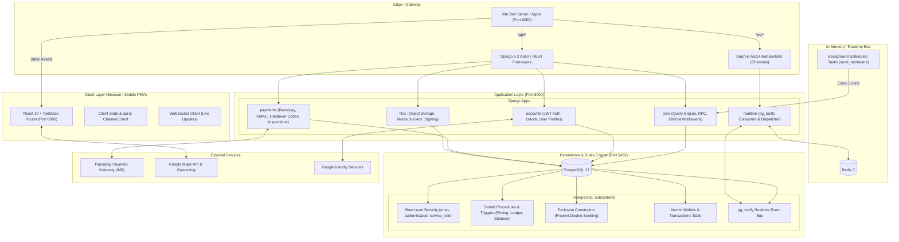
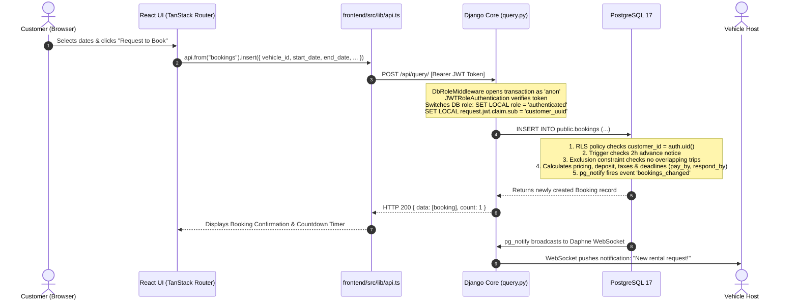

# Synchoo System Dossier — 00: Executive Summary & 5-Year-Old Guide

## 1. The 5-Year-Old Analogy: "The Magic Toy Car Clubhouse"

Imagine you and your friends love cars and bikes. You decide to build a giant **Magic Toy Car Clubhouse** in your backyard called **Synchoo**.

Here is how the Clubhouse works:

1. **The Clubhouse Reception Desk (Frontend — React 19):**
   - When a friend walks in, they look at a colorful touch screen with shiny pictures of toy sports cars, family vans, bicycle washes, and friendly chauffeurs.
   - They tap buttons to say: *"I want to rent this red sports car for Saturday,"* or *"I need someone to wash my muddy jeep,"* or *"I want to share a ride to the playground."*
   - This screen doesn't make any big decisions—it just looks pretty and sends requests through a pneumatic tube into the secret basement vault.

2. **The Security Guard & The Butler (Backend — Django & Daphne):**
   - Inside the clubhouse basement sits a butler named **Django**.
   - Django takes the notes coming down the tube. He checks who sent them, makes sure the note is written in polite language, and passes it directly to the boss who holds the keys.
   - For walkie-talkies (WebSockets), another quick butler named **Daphne** whispers instant messages whenever something changes (*"Hey! The cleaner just arrived at your toy jeep!"*).

3. **The Boss with the Unbreakable Rulebook (Database — PostgreSQL 17):**
   - Deep underground lives the ultimate master: **PostgreSQL**.
   - Unlike other toy clubs where the butler makes up rules, here **all the rules live inside the master's magical locked vault**.
   - The master has a rulebook: *"No one can borrow a car unless they pay," "Two kids can never have the same car at the same minute," "If a friend is late, return their money automatically."*
   - Even if the butler gets confused, the master will strictly say: *"Denied! Rule #12 violated!"*

4. **The Magic Wristbands (Authentication & RBAC):**
   - When you enter the clubhouse, the gatekeeper hands you a glowing wristband (a **JWT Token**).
   - Your wristband tells everyone who you are.
   - If your wristband says **"Customer"**, you can browse cars and rent them.
   - If it says **"Host"**, you can put your own car up for rent and view your earnings.
   - If it says **"Driver"**, you can accept jobs.
   - If it has a shiny golden badge that says **"Admin"**, you can open any door and settle disputes.
   - Every single door in the vault checks the wristband before letting anyone in (**Row-Level Security**).

5. **The Piggy Bank & Token Machine (Wallets & Razorpay):**
   - Each kid has a glass piggy bank (**Wallet**). Every coin in and out is written on an official ledger paper (**Double-Entry Bookkeeping**).
   - If you want to use real rupees from your mom's card, a trusted armored bank car (**Razorpay**) brings in the coins. The bank car gives you a secret stamped receipt (**Idempotency Key & Signature**). Even if the delivery driver drops the receipt twice, the master piggy bank only counts it once!

6. **The School / Office Carpool Club (Corporate Travel):**
   - What if a whole classroom or office wants to use the clubhouse?
   - The teacher sets rules: *"Kids can only spend 50 clubhouse coins per day, only on school trips, and the class captain must sign off first."*
   - If the class captain falls asleep for 2 hours, the clubhouse automatically cancels the pending ride so the car isn't locked up forever!

---

## 2. High-Level Architecture (The Architect's View)

Synchoo is architected as an **engine of business rules inside PostgreSQL**, wrapped by a high-throughput **Django ASGI backend**, served to a modern **React 19 SPA frontend**, and interconnected with real-time WebSockets and Razorpay payment rails.

---

## 3. Technology Matrix

| Technology | Role in Synchoo | Why It Is Used | Key Location in Codebase |
|---|---|---|---|
| **PostgreSQL 17** | **Single Source of Truth & Rules Engine** | Runs triggers, RLS, pricing, double-booking exclusion constraints, and wallet ledger. Prevents business logic duplication. | `backend/sql/schema.sql`, `backend/core/migrations/` |
| **Django 5.2** | **Backend API & Orchestration** | Robust ORM for auth, clean request middleware, simple JWT integration, and server-side secret handling. | `backend/core/`, `backend/accounts/` |
| **Daphne & Channels** | **ASGI WebSocket Server** | Handles persistent asynchronous WebSocket connections for chat, notifications, and location tracking. | `backend/realtime/`, `backend/config/asgi.py` |
| **React 19 & Vite** | **Frontend SPA & PWA** | Lightning-fast rendering, optimistic UI updates, component modularity, instant hot module reloading. | `frontend/src/` |
| **TanStack Router** | **Type-Safe File-Based Routing** | 100% type-safe search params, nested layouts (`_authenticated`), fast route prefetching, zero runtime route drift. | `frontend/src/routes/`, `frontend/src/routeTree.gen.ts` |
| **Tailwind v4 & shadcn/ui** | **Design System** | Accessible, headless, modern components with clean light-first aesthetic and dark-mode toggle. | `frontend/src/components/ui/`, `frontend/src/styles.css` |
| **Razorpay (INR)** | **Payment Processing** | Domestic Indian rupee support, UPI, credit/debit cards, NetBanking, automated webhook reconciliation. | `backend/payments/views.py`, `frontend/src/lib/actions.ts` |
| **Redis** | **Channel Layer & In-Memory Cache** | Sub-millisecond pub/sub message broker for Channels and lightning-fast cache for platform settings and rate limits. | `backend/config/settings.py` |
| **Docker Compose** | **Local & Production Orchestration** | Spins up Postgres, Redis, Django, and Vite in isolated reproducible containers with a single command. | `docker-compose.yml` |

---

## 4. End-to-End Life of a Booking Request

To understand the architecture as both a developer and an architect, follow what happens when a user books a car:

