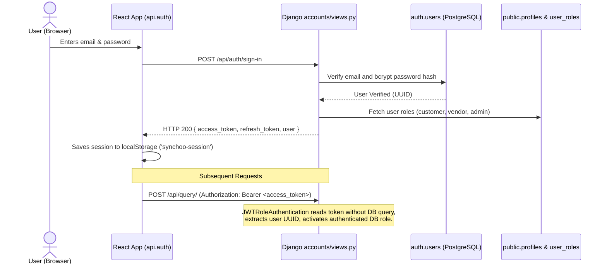

# Synchoo System Dossier — 01: RBAC, Authentication & Security

## 1. The 5-Year-Old Explanation: "The Theme Park Wristbands"

Imagine you go to a giant theme park.
- **Authentication ("Who are you?"):** At the main gate, you show your ID card. The ticket officer checks your face, says *"Welcome, Alex!"*, and snaps a glowing plastic wristband on your arm. Inside that wristband is an invisible chip that contains your name (**JWT Token**). Every time you want to ride a rollercoaster, you just tap your wristband. You don't have to show your birth certificate again!
- **Authorization & RBAC ("What are you allowed to play?"):** The wristband has different colored stripes:
  - **Green Stripe (Customer):** You can ride the cars, order ice cream, and swim in the pool.
  - **Yellow Stripe (Host / Vendor):** You can put your own go-kart into the park and collect ticket points.
  - **Blue Stripe (Driver):** You are licensed to drive younger kids on the safari track.
  - **Gold Badge (Admin):** You can open the control room, inspect the safety brakes, and resolve disputes.
- **Row-Level Security (The Guard at Every Single Door):** In most computer systems, the receptionist decides whether you can open a locker. If the receptionist is tricked, anyone can open your locker! But in Synchoo, **every single locker has its own armed guard (PostgreSQL RLS)**. Even if the receptionist drops all the keys on the floor, the guard at Locker #42 looks at your wristband chip: *"Your chip says Alex, but this locker belongs to Sam. Access denied!"*

---

## 2. Authentication Architecture

### 2.1 The Authentication Flow

Synchoo uses stateless JSON Web Tokens (**SimpleJWT** in Django) combined with an email/password and Google Identity Services OAuth system:



### 2.2 Token Lifecycle & Refresh Rotation

- **Access Token:** Short-lived (typically 1 hour) JWT token containing `user_id` and token expiration claims. It is stateless—Django verifies its cryptographic signature without needing to query the database.
- **Refresh Token:** Long-lived (e.g. 7 days). When the access token expires:
  1. The client intercepts the 401 error.
  2. Calls `POST /api/auth/refresh` with the refresh token.
  3. The server blacklists the old refresh token (preventing replay attacks) and issues a brand-new access/refresh token pair.

---

## 3. RBAC (Role-Based Access Control) in Synchoo

In Synchoo, user permissions are **multi-tenant and multi-role**: a single user can simultaneously be a Customer, a Vehicle Host, and an authorized Driver.

### 3.1 The Role Hierarchy

| Role | Stored In | Assigned When | Capabilities |
|---|---|---|---|
| **customer** | `public.user_roles` | Automatically on signup via DB trigger | Browse vehicles, request bookings, hire drivers, book car washes, join pool trips, manage personal wallet. |
| **vendor** (Host) | `public.vendors` & `public.user_roles` | When user lists their first vehicle | Add/edit vehicles, set daily pricing and discounts, accept/reject booking requests, view host payout earnings. |
| **driver** | `public.drivers` & `public.user_roles` | Profile submitted + Admin approved | Set hourly/daily rates, select service areas, accept driver bookings, view driver payout earnings. |
| **cleaner** | `public.cleaners` & `public.user_roles` | Profile submitted + Admin approved | Accept doorstep wash jobs from the dispatch job board, update wash progress. |
| **wash_center** | `public.wash_centers` & `public.user_roles` | Center registered + Admin approved | Manage wash center packages, assign bay staff, accept wash bookings. |
| **admin** | `public.user_roles` | Assigned directly via secure SQL | View platform analytics, approve KYC documents, moderate reviews, refund bookings, resolve incident disputes. |

---

## 4. Database-Level Enforcement: Row-Level Security (RLS)

This is the most critical architectural decision in Synchoo: **Django does not enforce data ownership in Python code. PostgreSQL enforces it at the database storage engine layer.**

### 4.1 The Three Database Roles

Every SQL query in Synchoo runs under one of three PostgreSQL roles:

```mermaid
flowchart TD
    Req[Incoming HTTP Request] --> MW[DbRoleMiddleware]
    MW -->|Transaction Starts| AnonRole["SET LOCAL role = 'anon'"]
    
    AnonRole --> AuthCheck{Has Valid JWT Token?}
    AuthCheck -->|No| KeepAnon["Remains 'anon'<br/>(Can only view public vehicles, reviews, public drivers)"]
    AuthCheck -->|Yes| SetAuth["JWTRoleAuthentication calls:<br/>SET LOCAL role = 'authenticated'<br/>SET LOCAL request.jwt.claim.sub = user_id"]
    
    SetAuth --> ServerActionCheck{Is Server-Privileged Action?}
    ServerActionCheck -->|No| RunAuthQuery["Runs as 'authenticated'<br/>RLS filters rows where auth.uid() matches"]
    ServerActionCheck -->|Yes (e.g. Webhook, Payout)| ServiceRole["with db_role('service_role'):<br/>Can modify locked columns (payment_status, refund_amount)"]
```

### 4.2 How `DbRoleMiddleware` and `core/auth.py` Work

Look at [backend/core/middleware.py](file:///C:/Users/gclik/Desktop/Projects/Stalight%20Technologies/stalightride/backend/core/middleware.py):

```python
class DbRoleMiddleware:
    """One transaction per request, starting as `anon`.
    Authentication upgrades the role to `authenticated` for a signed-in user,
    so code that forgets to authenticate gets the least access, not the most.
    """
    def __call__(self, request):
        with transaction.atomic():
            set_db_role("anon")
            response = self.get_response(request)
            if response.status_code >= 400:
                transaction.set_rollback(True)
        return response
```

And [backend/core/auth.py](file:///C:/Users/gclik/Desktop/Projects/Stalight%20Technologies/stalightride/backend/core/auth.py):

```python
class JWTRoleAuthentication(JWTStatelessUserAuthentication):
    def authenticate(self, request):
        result = super().authenticate(request)
        if result is not None:
            # result[0] is the StatelessUser containing token payload
            set_db_role("authenticated", result[0].id)
        return result
```

And in [backend/core/db.py](file:///C:/Users/gclik/Desktop/Projects/Stalight%20Technologies/stalightride/backend/core/db.py):

```python
_SET = "SELECT set_config('role', %s, true), set_config('request.jwt.claim.sub', %s, true)"

def _switch(role, user_id):
    with connection.cursor() as c:
        c.execute(_SET, [role, str(user_id) if user_id else ""])
```
*Note: `set_config(..., true)` sets the parameter **locally for the current transaction only**. It can never leak into another connection or request!*

### 4.3 Concrete SQL RLS Policy Examples

Look at how PostgreSQL protects data in `backend/sql/schema.sql`:

```sql
-- 1. Bookings policy: Only the customer who booked it, the vehicle host, or an admin can see the booking!
CREATE POLICY "Parties view booking" ON public.bookings
  FOR SELECT TO authenticated
  USING (
    auth.uid() = customer_id 
    OR auth.uid() = vendor_id 
    OR public.has_role(auth.uid(), 'admin'::public.app_role)
  );

-- 2. Wallets policy: A user can ONLY view their own wallet balance!
CREATE POLICY "Users read own wallet" ON public.wallets
  FOR SELECT TO authenticated
  USING (auth.uid() = user_id);

-- 3. Locking sensitive columns: Users cannot update payment_status!
-- Regular users can only update bookings if it passes:
CREATE POLICY "Parties update booking" ON public.bookings
  FOR UPDATE TO authenticated
  USING (auth.uid() = customer_id OR auth.uid() = vendor_id OR public.has_role(auth.uid(), 'admin'))
  WITH CHECK (auth.uid() = customer_id OR auth.uid() = vendor_id OR public.has_role(auth.uid(), 'admin'));
-- But a trigger raises an exception if 'payment_status' or 'provider_earning' is changed by an ordinary user:
-- Only service_role can write those columns!
```

---

## 5. How to Read & Write Auth Code

### Frontend Check (Developer Recipe)

To check if a user is logged in or is an admin in React:

```typescript
// 1. Get current logged-in user from api.ts
const user = api.auth.getUser();
if (!user) {
  // redirect to login
}

// 2. Check if user is an admin using the hook:
import { useIsAdmin } from "@/hooks/use-is-admin";

function AdminButton() {
  const { isAdmin, loading } = useIsAdmin();
  if (loading || !isAdmin) return null;
  return <a href="/admin">Admin Panel</a>;
}
```

### Backend Check (Developer Recipe)

In Django views or server functions:

```python
# In backend/payments/views.py:
def resolve_dispute_compensation(data, user_id):
    # Check admin role via database RPC
    if not _is_admin(user_id):
        raise FnError("Admins only", status=403)
        
    # Execute privileged database operation safely
    with db_role("service_role"):
        return run_rpc("resolve_dispute_compensation", { ... })
```
