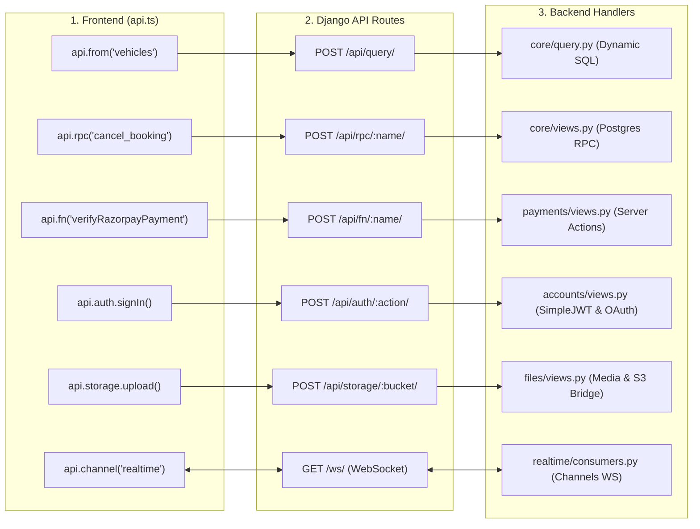
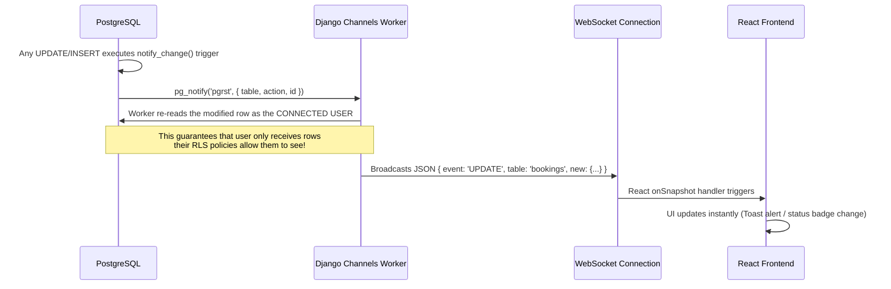

# Synchoo System Dossier — 02: APIs, Query Engine & Data Flow

## 1. The 5-Year-Old Explanation: "The Magic Restaurant Menu"

Imagine you go to a magical restaurant:
- **The Old Boring Way (Traditional REST APIs):** In old restaurants, the menu has separate fixed plates: Plate #1 is chicken with rice. Plate #2 is chicken with fries. If you want chicken with noodles, the waiter says: *"Sorry! The chef has to invent a brand new Plate #3 and re-print the whole menu!"*
- **The Synchoo Way (Declarative Query Engine):** In Synchoo, the menu is like a magical Lego builder! You write on a note: *"Please bring me a car, but only give me its picture and title, and also bring the owner's phone number, but only if the car is located in Bengaluru and costs less than 2,000 coins."*
- You drop that note into the order box (`/api/query/`).
- The smart waiter (**`core/query.py`**) inspects your note:
  1. He checks his dictionary to make sure every word is a real menu item (preventing bad words / SQL injection).
  2. He checks if your wristband is allowed to see the owner's phone number (**Row-Level Security**).
  3. He quickly walks into the kitchen, gets the exact items you asked for, and brings them back in a clean little box `{ data: [...], error: null }`!

---

## 2. Synchoo's 5 API Modalities

Synchoo does not write 500 individual CRUD REST endpoints (like `/get-booking-by-id`, `/update-booking-status`, `/list-vehicles-by-city`). Instead, it uses **5 purposeful communication channels**:



### Quick Architecture Mapping

| Channel | Frontend Method (`api.ts`) | HTTP/WS Endpoint | Backend Handler | Primary Purpose |
|---|---|---|---|---|
| **1. Query API** | `api.from(table).select(...)` | `POST /api/query/` | `core/query.py` | Declarative reads/writes running directly under RLS |
| **2. RPC API** | `api.rpc(funcName, params)` | `POST /api/rpc/:name/` | `core/views.py` | Executes atomic PostgreSQL stored procedures |
| **3. Server Actions** | `api.fn(actionName, payload)` | `POST /api/fn/:name/` | `payments/views.py` | Razorpay orders, HMAC verification, inspections |
| **4. Auth API** | `api.auth.signInWithPassword()` | `POST /api/auth/:action/` | `accounts/views.py` | User signup, login, refresh tokens, Google OAuth |
| **5. Storage API** | `api.storage.from(b).upload()` | `POST /api/storage/:bucket/` | `files/views.py` | Photo uploads & signed temporary URLs |
| **6. Realtime WS** | `api.channel(topic).on(...)` | `GET /ws/` | `realtime/consumers.py` | Live chat, booking status, and push alerts |

---

## 3. Deep Dive: The Declarative Query Engine (`core/query.py`)

### 3.1 Why It Exists
In traditional architectures, frontends constantly need new combinations of fields and relations. Backends quickly become cluttered with hundreds of ad-hoc serializers and views.
Synchoo's `core/query.py` provides a **Supabase-like syntax** over Django and PostgreSQL, with **enterprise-grade security guards**:

1. **Catalog Verification:** Every table and column name is checked against PostgreSQL's `information_schema.columns`. If an identifier doesn't exist, it is rejected immediately before reaching SQL execution.
2. **Strict Parameter Binding:** All user values are passed as parameterized `%s` query inputs. Zero string concatenation of user input exists, completely eliminating SQL injection risks.
3. **Automatic Foreign Key Joins (Embedded Relations):** If you request `select("*, vehicles(title, image_url)")`, the compiler inspects PostgreSQL foreign keys and automatically crafts a sub-select with `json_build_object()`.
4. **Hard 1,000-Row Limit:** Prevents any query from exhausting server memory or performing denial-of-service table dumps.

### 3.2 How a Frontend Call Becomes SQL

#### Frontend Code:
```typescript
const { data, error } = await api
  .from("bookings")
  .select("id, status, total_price, vehicles(title, registration_number)")
  .eq("customer_id", user.id)
  .order("created_at", { ascending: false })
  .limit(10);
```

#### What Travels over HTTP (`POST /api/query/`):
```json
{
  "table": "bookings",
  "select": "id, status, total_price, vehicles(title, registration_number)",
  "filters": [["customer_id", "eq", "a4f89d32-b765-4290-a5ef-e6c10970db1a"]],
  "order": [["created_at", "desc"]],
  "limit": 10
}
```

#### What `core/query.py` Compiles & Executes in PostgreSQL:
```sql
SELECT 
  t.id, 
  t.status, 
  t.total_price,
  (
    SELECT json_build_object('title', r.title, 'registration_number', r.registration_number)
    FROM public.vehicles r
    WHERE r.id = t.vehicle_id
  ) AS vehicles
FROM public.bookings t
WHERE t.customer_id = %s
ORDER BY t.created_at DESC
LIMIT 10;
```
*Note: Because this query executes under `role = 'authenticated'`, PostgreSQL's RLS policies apply automatically.*

---

## 4. The RPC Engine (`/api/rpc/<name>/`)

For operations that modify business state, Synchoo uses **Stored Procedures (Functions)** in PostgreSQL.

### Why Use Database RPCs?
1. **Atomic Integrity:** Checking business invariants, mutating 3 different tables, updating balances, and inserting audit logs happen within a single ACID transaction inside PostgreSQL.
2. **Zero Network Latency Between Steps:** 10 database operations execute in microsecond C-speed memory inside PostgreSQL without 10 round trips between Python and PostgreSQL.
3. **Guaranteed Security:** `SECURITY DEFINER` functions run with strict grants (`REVOKE ALL FROM PUBLIC; GRANT EXECUTE TO authenticated;`).

### Example: Cancelling a Booking
In `frontend/src/routes/_authenticated/bookings.tsx`:
```typescript
const { error } = await api.rpc("cancel_booking", {
  _booking_id: bookingId,
  _reason: "Change of plans"
});
```

Backend view in [backend/core/views.py](file:///C:/Users/gclik/Desktop/Projects/Stalight%20Technologies/stalightride/backend/core/views.py):
```python
@api_view(["POST"])
def rpc(request, name):
    return guarded(lambda: {"data": run_rpc(name, request.data)})
```

Inside PostgreSQL (`schema.sql`):
```sql
CREATE OR REPLACE FUNCTION public.cancel_booking(_booking_id uuid, _reason text DEFAULT NULL)
RETURNS jsonb LANGUAGE plpgsql SECURITY DEFINER AS $$
DECLARE b RECORD; refund numeric; share numeric;
BEGIN
  -- 1. Lock the booking row
  SELECT * INTO b FROM public.bookings WHERE id = _booking_id FOR UPDATE;
  
  -- 2. Authorization check
  IF b.customer_id <> auth.uid() AND NOT public.has_role(auth.uid(), 'admin') THEN
    RAISE EXCEPTION 'Not authorized to cancel this booking';
  END IF;
  
  -- 3. Calculate refund tiers based on cancellation deadline
  ...
  -- 4. Atomically credit customer wallet & host cancellation fee
  PERFORM public.wallet_apply(b.customer_id, refund, 'refund', b.id, NULL, 'Booking cancellation refund');
  ...
  RETURN jsonb_build_object('ok', true, 'refund', refund);
END; $$;
```

---

## 5. Server Actions (`/api/fn/<name>/`)

When an operation requires talking to external third parties (like Razorpay's API) or performing sensitive checks before elevating to `service_role`, it is handled by **Server Actions** in `backend/payments/views.py`.

### Registered Functions in `payments/views.py`:
- `createRazorpayOrder` / `verifyRazorpayPayment`
- `createDriverRazorpayOrder` / `verifyDriverRazorpayPayment`
- `createWashRazorpayOrder` / `verifyWashRazorpayPayment`
- `createWalletTopupOrder` / `verifyWalletTopup`
- `submitInspection` (Validates 360° photo URLs, checks odometer delta, verifies 6-digit handover code with failure throttling)
- `createMembershipOrder` / `subscribeMembership`
- `redeemRewardVoucher`
- `resolveDisputeCompensation` (Admin only)

---

## 6. Realtime WebSockets (`/ws/`)

Synchoo provides live reactivity using **Django Channels (Daphne)** combined with PostgreSQL's built-in `pg_notify`:



---

## 7. How to Read & Write API Code (Developer Cheat Sheet)

### 1. Reading Data (SELECT)
```typescript
// Read multiple rows with filter and sorting
const { data, error } = await api
  .from("vehicles")
  .select("id, title, price_per_day, category, images:vehicle_images(image_url)")
  .eq("is_active", true)
  .gte("price_per_day", 1000)
  .order("price_per_day", { ascending: true });

// Read single row safely
const { data: vehicle, error } = await api
  .from("vehicles")
  .select("*")
  .eq("id", vehicleId)
  .maybeSingle(); // returns null instead of throwing if not found
```

### 2. Writing Data (INSERT & UPDATE)
```typescript
// Insert a record
const { data, error } = await api
  .from("support_tickets")
  .insert({
    subject: "Need help with pickup",
    message: "Host is not picking up the call",
    category: "booking_issue"
  });

// Update a record
const { error } = await api
  .from("profiles")
  .update({ phone: "+919876543210" })
  .eq("id", user.id);
```

### 3. Calling an RPC
```typescript
const { data, error } = await api.rpc("apply_coupon_code", {
  _coupon_code: "STARLIGHT50",
  _total_amount: 3500
});
```

### 4. Calling a Server Action
```typescript
import { createRazorpayOrder, verifyRazorpayPayment } from "@/lib/actions";

// Server actions throw errors on failure, so use try/catch:
try {
  const order = await createRazorpayOrder({ bookingId });
  // Open Razorpay Checkout modal...
} catch (err: any) {
  toast.error(err.message);
}
```
