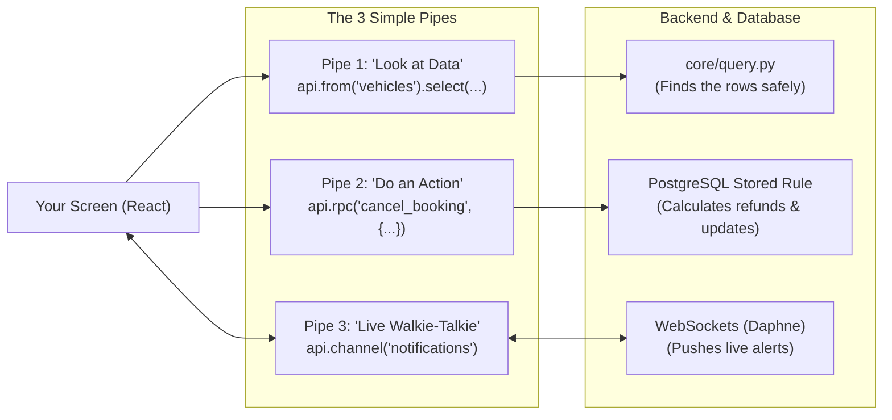

# Synchoo System Dossier — 02: APIs & How Data Moves (Made Simple)

> **TL;DR (The 30-Second Summary):**
> In most web apps, developers write hundreds of tiny backend endpoints for every single button (`/get-cars-in-city`, `/get-car-details`, `/cancel-ride`).
>
> In Synchoo, we keep it super simple. We have **just 3 main pipes**:
>
> 1. **The "Look Around" Pipe (`api.from`):** The frontend asks for whatever data it needs directly.
> 2. **The "Do a Rule-Based Action" Pipe (`api.rpc` & `api.fn`):** The frontend tells the database or server to do a complex task (like cancelling a ride or paying).
> 3. **The "Walkie-Talkie" Pipe (`api.channel`):** The database sends live alerts to the screen the instant something changes.

---

## 1. Why is Synchoo Built This Way? (The Pizza Menu Story)

Imagine two different pizza restaurants:

* **The Complicated Restaurant (Traditional REST):**
  The menu has 500 pre-printed fixed combos:

  - Combo 1: Pizza with cheese.
  - Combo 2: Pizza with cheese and onions.
  - Combo 3: Pizza with cheese, onions, and extra sauce.
    If you want pizza with cheese and mushrooms, the waiter stops you: *"Sorry! The kitchen programmer hasn't written a 'Combo 4' yet. You have to wait 2 days for an update!"*
* **The Synchoo Restaurant (Our Query System):**
  The waiter brings you a small blank order card. You write:
  *"Please bring me 1 pizza, but only give me cheese and mushrooms, and show me the price."*
  The waiter checks the kitchen pantry, grabs exactly what you asked for, and brings it straight to your table.

That is how `api.from("vehicles").select("title, price_per_day")` works! The frontend specifies what it wants, and the backend delivers it immediately.

---

## 2. The 3 Simple Pipes Explained

Here is how the browser talks to the backend and database:



---

### Pipe 1: "I want to look at data" (`api.from`)

Whenever the screen needs to display something from the database (a list of cars, your profile, your past bookings), you use `api.from()`.

#### How it looks in your code:

```typescript
// "Hey database, show me active cars in Bengaluru, sorted by price"
const { data, error } = await api
  .from("vehicles")
  .select("id, title, price_per_day, city")
  .eq("city", "Bengaluru")
  .eq("is_active", true)
  .order("price_per_day", { ascending: true });
```

#### What happens behind the scenes:

1. Your browser sends a clean JSON note to `POST /api/query/`.
2. A file named `backend/core/query.py` receives the note.
3. It checks: *"Is 'vehicles' a real table? Are 'city' and 'price_per_day' real columns?"* (This protects against hackers).
4. It checks your user wristband (**Row-Level Security**): You only get to see rows you are allowed to see.
5. It sends back `{ data: [...], error: null }`.

---

### Pipe 2: "I want to do an action" (`api.rpc` & `api.fn`)

When you aren't just reading, but **doing something serious** (like cancelling a trip, paying money, or applying a coupon), you don't just edit a database table directly. That would be dangerous!

Instead, you push an "Action Button":

#### A. Database Rules (`api.rpc`):

Used when PostgreSQL handles the entire business calculation (e.g. calculating refunds, checking dates, updating balances).

```typescript
// "Hey database, cancel this booking and follow the refund rules"
const { data, error } = await api.rpc("cancel_booking", {
  _booking_id: "some-booking-uuid",
  _reason: "Customer emergency"
});
```

*Why this is great:* The database locks the row, checks how many hours are left before the trip, calculates the exact refund percentage, puts the coins back into your wallet, and marks the trip cancelled—**all in one single step**. If anything goes wrong, it cancels the whole thing automatically.

#### B. Outside Server Actions (`api.fn`):

Used when we have to talk to the outside world, like **Razorpay bank servers** or verifying photo uploads.

```typescript
import { createRazorpayOrder, verifyRazorpayPayment } from "@/lib/actions";

// 1. Create a bank order with Razorpay
const order = await createRazorpayOrder({ bookingId: "123" });

// 2. Once the user pays via UPI/Card, verify the bank signature
await verifyRazorpayPayment({
  bookingId: "123",
  razorpay_order_id: response.razorpay_order_id,
  razorpay_payment_id: response.razorpay_payment_id,
  razorpay_signature: response.razorpay_signature,
});
```

---

### Pipe 3: "The Walkie-Talkie" (`api.channel`)

In old websites, if a host accepted your trip, you wouldn't know until you refreshed your page!

In Synchoo, we have a live walkie-talkie connection (**WebSockets**):

1. The host clicks "Accept".
2. PostgreSQL fires an internal whisper (`pg_notify`).
3. The server catches that whisper and sends it down the walkie-talkie wire straight to the customer's screen.
4. The customer's bell icon turns red and a popup says: *"Your trip was accepted!"* without any page refresh!

---

## 3. The 4 Golden Snippets (How to Write Code Yourself)

Whenever you want to build or change a feature, you only ever need these 4 recipes:

### Recipe 1: Fetch a list of items

```typescript
const { data, error } = await api
  .from("reviews")
  .select("rating, comment, user_name")
  .eq("vehicle_id", myVehicleId);
```

### Recipe 2: Fetch one single item

```typescript
const { data: car, error } = await api
  .from("vehicles")
  .select("*")
  .eq("id", myVehicleId)
  .maybeSingle(); // returns null if not found (doesn't crash!)
```

### Recipe 3: Save a new record

```typescript
const { error } = await api
  .from("support_tickets")
  .insert({
    subject: "Car was clean and host was polite",
    category: "general"
  });
```

### Recipe 4: Update an existing record

```typescript
const { error } = await api
  .from("profiles")
  .update({ full_name: "Bruce Wayne" })
  .eq("id", user.id);
```

---

## 4. Summary Checklist for Developers

| What do you want to do?                 | What tool do you use?          | Where is the code?                                                 |
| --------------------------------------- | ------------------------------ | ------------------------------------------------------------------ |
| Read or write simple data               | `api.from("table_name")`     | Frontend: `src/lib/api.ts`Backend: `backend/core/query.py`     |
| Run a complex database business rule    | `api.rpc("function_name")`   | Database: `backend/sql/schema.sql`                               |
| Take a Razorpay payment or check photos | `api.fn("function_name")`    | Backend: `backend/payments/views.py`                             |
| Log in, sign up, or sign out            | `api.auth.*`                 | Frontend: `src/lib/api.ts`Backend: `backend/accounts/views.py` |
| Upload photos or documents              | `api.storage.from("bucket")` | Backend: `backend/files/views.py`                                |
| Listen for live real-time updates       | `api.channel("topic")`       | Backend: `backend/realtime/consumers.py`                         |
