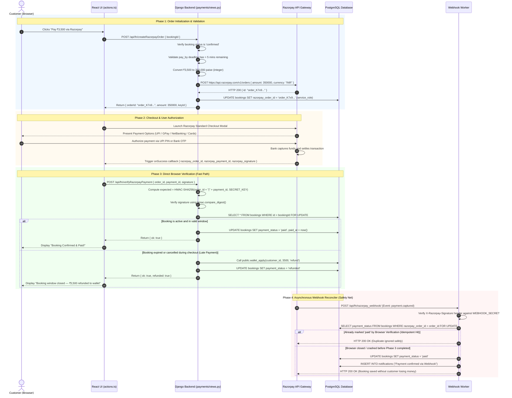

# Synchoo System Dossier — 03: Payments, Idempotency & Financial Consistency

## 1. The 5-Year-Old Explanation: "The Magic Piggy Bank & Stamped Receipts"

Imagine you have a magic piggy bank:

- **The Problem (Double Spending or Double Charging):** You put 10 shiny coins into your piggy bank to buy a toy car. You hand the receipt to the cashier. Just as you hand it, your baby brother yells, your internet freezes, and you accidentally press the button twice! In a broken toy store, the cashier takes 20 coins instead of 10!
- **The Solution: The Secret Stamped Receipt (Idempotency Key):**
  - In Synchoo, every time you buy something, the bank officer stamps a unique serial number on your receipt (for example: `REC-9941`).
  - When the cashier sees `REC-9941`, she puts 10 coins into your piggy bank and writes `REC-9941: DONE` in her gold record book.
  - If you click the button 5 more times, or if the mail carrier delivers the same receipt tomorrow, the cashier looks at her book: *"I already processed REC-9941! Here is your confirmation, I will NOT take or give coins again."*
- **The Indestructible Bank Ledger (Double-Entry Bookkeeping):**
  - In Synchoo, we never just change your balance with an eraser.
  - Every single coin added or removed has a permanent, ink-written diary entry: *"Added 500 coins from Razorpay," "Deducted 200 coins for Toyota Rental," "Added 50 coins refund for late cancellation."*
  - The balance is always mathematically identical to the sum of all diary entries.

---

## 2. End-to-End Razorpay Payment Architecture

Synchoo uses Razorpay for domestic INR payments (supporting UPI, Cards, NetBanking, and Wallets).



### End-to-End Step-by-Step Breakdown Table

| Step # | Phase | What Happens | Security & Consistency Guarantee |
|:---:|---|---|---|
| **1–4** | **Order Creation** | Frontend requests an order. Backend validates that the booking is confirmed, verifies that the payment window (`pay_by`) has not expired, converts rupees to paise, and calls Razorpay API. | Only signed-in customers can create orders for their own bookings. |
| **5–7** | **Order Persistence** | Razorpay returns `order_id`. Backend records `razorpay_order_id` in the database under `service_role` and passes the order ID to the frontend. | Stores the order receipt before opening checkout to anchor idempotency. |
| **8–11** | **User Checkout** | Frontend opens the Razorpay Modal. Customer authenticates with UPI PIN or card OTP. Bank captures money and returns payment credentials to the frontend. | Sensitive card numbers/PINs never touch Synchoo servers. |
| **12–15** | **Browser Verification** | Frontend sends `{ order_id, payment_id, signature }` to `/api/fn/verifyRazorpayPayment`. Backend computes HMAC-SHA256 and locks the row `FOR UPDATE`. | Cryptographic tamper-proofing: amount and order cannot be altered by client script. |
| **16–17** | **Late-Payment Protection** | If booking expired while user was typing their OTP, backend triggers `wallet_apply` to immediately credit 100% of money back to customer wallet. | Customer never loses money on expired bookings. |
| **18–22** | **Webhook Reconciler** | If user's battery dies or browser closes right after payment, Razorpay webhooks call `/api/fn/razorpay_webhook/`. Backend re-checks state idempotently and marks it paid. | Guarantees bookings are never stuck in unpaid limbo. |

---

## 3. Cryptographic Signature Verification (`_check_signature`)

Never trust client-reported success without server verification! In [backend/payments/views.py](<file:///C:/Users/gclik/Desktop/Projects/Stalight%20Technologies/stalightride/backend/payments/views.py>):

```python
def _check_signature(data):
    """Verify that Razorpay actually received the money using HMAC-SHA256."""
    order_id = _text(data, "razorpay_order_id")
    payment_id = _text(data, "razorpay_payment_id")
    signature = _text(data, "razorpay_signature")
    key_id, secret = _credentials()
  
    # Message is order_id + "|" + payment_id
    body = f"{order_id}|{payment_id}".encode("ascii")
    expected = hmac.new(secret.encode("ascii"), body, hashlib.sha256).hexdigest()
  
    # Constant-time comparison prevents timing attacks!
    if not hmac.compare_digest(signature, expected):
        raise FnError("Payment signature verification failed")
      
    return order_id, payment_id
```

---

## 4. Idempotency Keys in Action

### 4.1 What is Idempotency?

An operation is **idempotent** if applying it once has the exact same effect as applying it 100 times:

$$
\forall N \ge 1: \quad f(x) = f^N(x)
$$

In payments, a non-idempotent system causes double charges, duplicate wallet credits, and financial loss.

### 4.2 The Wallet Top-Up Idempotency Engine

Look at how `verify_wallet_topup` in [backend/payments/views.py](<file:///C:/Users/gclik/Desktop/Projects/Stalight%20Technologies/stalightride/backend/payments/views.py>) guarantees absolute idempotency against concurrent retries and webhooks:

```python
def verify_wallet_topup(data, user_id):
    order_id, payment_id = _check_signature(data)
  
    with db_role("service_role"):
        with connection.cursor() as c:
            # 1. Pessimistic Row Lock: Only ONE process can examine or modify this top-up!
            c.execute(
                "SELECT id, user_id, amount, status FROM public.wallet_topups WHERE razorpay_order_id = %s FOR UPDATE",
                [order_id],
            )
            row = c.fetchone()
            if not row:
                raise FnError("Top-up not found")
            topup_id, topup_user_id, amount, status = row
          
            # 2. Authorization invariant
            if str(topup_user_id) != str(user_id):
                raise FnError("Not your top-up")
              
            # 3. IDEMPOTENCY CHECK: If already processed, return immediately WITHOUT crediting!
            if status == "paid":
                w = _get("wallets", "balance", "user_id", user_id)
                return {"ok": True, "alreadyCredited": True, "newBalance": float((w or {}).get("balance") or 0)}
              
            if status == "failed":
                raise FnError("This top-up can no longer be completed")
              
            # 4. Atomic state transition: from 'created' to 'paid'
            c.execute(
                "UPDATE public.wallet_topups SET status = 'paid', razorpay_payment_id = %s, updated_at = now() WHERE id = %s AND status = 'created'",
                [payment_id, topup_id],
            )
          
        # 5. Ledger update: executes inside the same atomic database transaction
        balance = run_rpc("wallet_apply", {
            "_user_id": user_id, 
            "_amount": amount, 
            "_kind": "topup",
            "_reference": payment_id, 
            "_description": "Money added to wallet"
        })
      
    return {"ok": True, "alreadyCredited": False, "newBalance": float(balance)}
```

### Why this is bulletproof:

1. If the user double-clicks, both requests hit the endpoint with the identical `order_id`.
2. The database's `FOR UPDATE` lock forces Request 2 to wait until Request 1 finishes.
3. Request 1 updates `status = 'paid'` and adds the coins via `wallet_apply`.
4. Request 2 wakes up, reads `status == 'paid'`, and immediately returns `alreadyCredited: True` with the existing balance, **without adding coins a second time!**

---

## 5. Double-Entry Wallet Ledger (`wallet_apply`)

Synchoo enforces strict double-entry ledger bookkeeping inside PostgreSQL (`backend/sql/schema.sql`):

```sql
CREATE FUNCTION public.wallet_apply(
  _user_id uuid, 
  _amount numeric, 
  _kind text, 
  _booking_id uuid DEFAULT NULL::uuid, 
  _reference text DEFAULT NULL::text, 
  _description text DEFAULT NULL::text
) RETURNS numeric LANGUAGE plpgsql SECURITY DEFINER AS $$
DECLARE new_balance numeric;
BEGIN
  -- 1. Ensure wallet row exists
  INSERT INTO public.wallets (user_id) VALUES (_user_id) ON CONFLICT (user_id) DO NOTHING;
  
  -- 2. Atomic in-place balance calculation
  UPDATE public.wallets 
     SET balance = balance + _amount 
   WHERE user_id = _user_id 
  RETURNING balance INTO new_balance;
  
  -- 3. Business Invariant: Balance can NEVER drop below zero!
  IF new_balance < 0 THEN 
    RAISE EXCEPTION 'Insufficient wallet balance'; 
  END IF;
  
  -- 4. Immutable Audit Ledger Entry
  INSERT INTO public.wallet_transactions (
    user_id, amount, kind, balance_after, booking_id, reference, description
  ) VALUES (
    _user_id, _amount, _kind, new_balance, _booking_id, _reference, _description
  );
  
  RETURN new_balance;
END; $$;
```

### Ledger Kinds:

- `topup`: Real money added via Razorpay.
- `booking_payment` / `driver_payment` / `wash_payment`: Money spent on services.
- `booking_earning` / `driver_earning` / `wash_earning`: Host/Driver/Cleaner share credited after trip.
- `refund` / `driver_refund` / `wash_refund`: Cancellation or late payment refund.
- `payout`: Host/driver withdraws money to bank account.
- `referral_bonus`: ₹500 promotion credit.

---

## 6. The Late-Payment Auto-Refund Safeguard

### The Edge Case:

A customer opens checkout for a rental. While typing their OTP, the 30-minute booking window expires, or the host cancels the booking. 1 minute later, the user completes the bank OTP and the payment succeeds!

### How Synchoo Solves It:

In both `verify_razorpay_payment` and `razorpay_webhook`:

```python
if b.get("status") in ("cancelled", "rejected"):
    _refund_late_rental_payment(b, payment_id)
    return {"ok": True}
```

`_refund_late_rental_payment()` automatically:

1. Calls `public.wallet_apply(b['customer_id'], b['total_price'], 'refund', ...)`
2. Marks the booking as `payment_status = 'refunded'`
3. Dispatches an urgent push notification to the customer:
   *"Your payment of Rs 3,500 was automatically refunded to your wallet because the booking window closed."*

---

## 7. Retry Mechanisms Across All Layers

| Layer                           | Trigger                                      | Strategy                                                           | Safety Guarantee                                    |
| ------------------------------- | -------------------------------------------- | ------------------------------------------------------------------ | --------------------------------------------------- |
| **Razorpay Webhooks**     | HTTP 5xx or network failure                  | Exponential backoff (retries up to 24 hours)                       | Idempotent handling via `razorpay_order_id` check |
| **Frontend Auth**         | HTTP 401 Unauthorized (Expired Access Token) | Automatic token refresh via `/api/auth/refresh`                  | Refresh token rotation and reuse detection          |
| **Database Transactions** | Deadlock / Serialization failure (`40P01`) | Immediate transaction rollback by `DbRoleMiddleware`             | Clean state reset without partial table updates     |
| **Handover Codes**        | Wrong 6-digit trip start code entered        | Cooldown throttling: locked for 15 minutes after 5 failed attempts | Prevents brute-force pin guessing attacks           |
