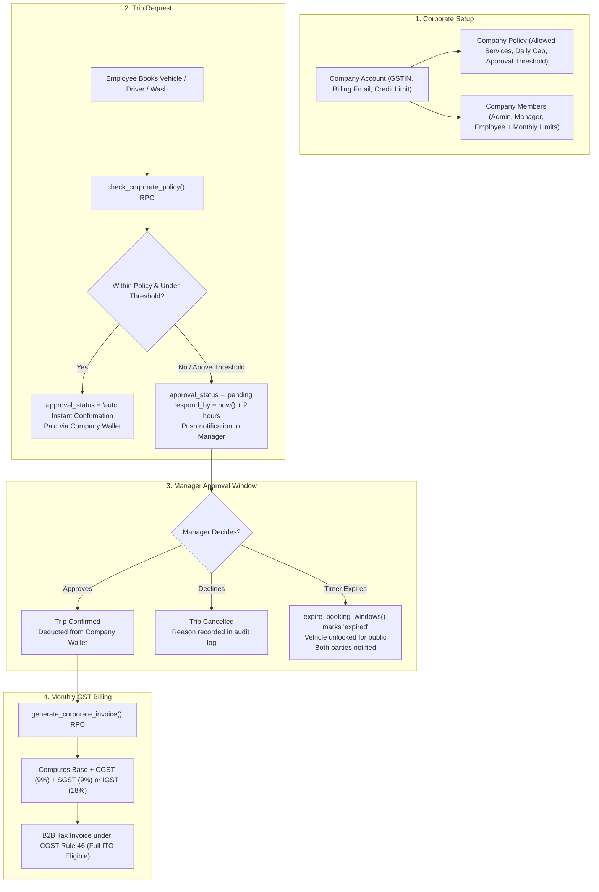

# Synchoo System Dossier — 05: Corporate Travel Subsystem & Enterprise Mobility

## 1. The 5-Year-Old Explanation: "The School Field Trip Permission Slip"

Imagine you and your school friends are going on a science museum trip:

- **The Problem Without Rules:** You want to hire a giant golden stretch limousine with a swimming pool inside! You tell the limousine driver: *"Send the million-dollar bill to my school principal!"* The principal would be furious, the school budget would be ruined, and nobody would get to go on any more trips.
- **The Solution (The Corporate Policy & Permission Slip):**
  - **The School Rulebook (Company Policy):** The school says: *"Students can only book regular mini-vans or bicycles. No luxury sports cars. Max 30 coins per day. Trips must be for school purposes."*
  - **The Fast Pass (Automatic Approval):** If you book a mini-van for 25 coins, the computer checks the rulebook: *"Under 30 coins? Allowed vehicle? You're approved right away! Enjoy your trip!"*
  - **The Teacher's Signature (Manager Approval Window):** If you need a special bigger van that costs 45 coins, the computer pauses: *"Hold on! This needs your teacher's permission slip."*
  - **The Countdown Timer:** Your teacher has a 2-hour window on her phone to press **"Approve"** or **"Decline"**. If the teacher falls asleep and the timer runs out, the trip is cancelled safely so the van owner isn't left waiting forever.
  - **The Official Tax Receipt (GST Invoicing):** At the end of the month, the school accountant gets a neat, official receipt with the school's tax number, so the government gives the school its tax money back (**Input Tax Credit**).

---

## 2. The Corporate Travel Business Problem

Modern enterprises face huge friction with employee business travel:

1. **Rogue & Out-of-Policy Spending:** Employees booking premium luxury vehicles or unapproved services on corporate cards.
2. **Delayed Manager Approvals:** Booking requests sit in email inboxes for days, causing vehicle hosts to reject the trips or vehicle availability to vanish.
3. **Receipt & Expense Chaos:** Employees paying from personal pockets, losing paper receipts, and waiting 60 days for HR reimbursement.
4. **GST Non-Compliance:** Without clean B2B GSTIN-compliant invoices under CGST Rule 46, corporations lose up to 18–28% in Input Tax Credit (ITC) refunds.

---

## 3. Synchoo's Solution: The Enterprise Mobility Suite

Implemented in Migration `0038_corporate_accounts_and_approval_windows.py` (CO-01 to CO-21), Synchoo provides an end-to-end, database-backed Corporate Mobility system.



---

## 4. Key Database Schema

The entire corporate architecture lives in 5 relational tables with strict RLS policies:

```sql
-- 1. Company entity
CREATE TABLE public.companies (
  id uuid PRIMARY KEY DEFAULT gen_random_uuid(),
  name text NOT NULL,
  gstin text NOT NULL UNIQUE,
  billing_email text NOT NULL,
  city text NOT NULL DEFAULT 'Bengaluru',
  verification_status text NOT NULL DEFAULT 'pending', -- pending, approved, rejected
  credit_limit numeric NOT NULL DEFAULT 0,
  wallet_balance numeric NOT NULL DEFAULT 0,
  status text NOT NULL DEFAULT 'active'
);

-- 2. Company membership with role & spending cap
CREATE TABLE public.company_members (
  id uuid PRIMARY KEY DEFAULT gen_random_uuid(),
  company_id uuid NOT NULL REFERENCES public.companies(id) ON DELETE CASCADE,
  user_id uuid NOT NULL REFERENCES public.profiles(id) ON DELETE CASCADE,
  role text NOT NULL DEFAULT 'employee', -- admin, manager, employee
  department text,
  monthly_limit numeric NOT NULL DEFAULT 10000,
  status text NOT NULL DEFAULT 'active',
  UNIQUE (company_id, user_id)
);

-- 3. Corporate mobility policy
CREATE TABLE public.company_policies (
  id uuid PRIMARY KEY DEFAULT gen_random_uuid(),
  company_id uuid NOT NULL REFERENCES public.companies(id) ON DELETE CASCADE UNIQUE,
  allowed_services text[] NOT NULL DEFAULT ARRAY['rental', 'driver', 'wash'],
  max_price_per_day numeric NOT NULL DEFAULT 5000,
  approval_threshold numeric NOT NULL DEFAULT 3000,
  require_manager_approval boolean NOT NULL DEFAULT true
);

-- 4. Corporate trip requests with lifecycle status
CREATE TABLE public.company_trips (
  id uuid PRIMARY KEY DEFAULT gen_random_uuid(),
  company_id uuid NOT NULL REFERENCES public.companies(id),
  member_id uuid NOT NULL REFERENCES public.company_members(id),
  service_type text NOT NULL, -- rental, driver, wash
  amount numeric NOT NULL,
  approval_status text NOT NULL DEFAULT 'pending', -- auto, pending, approved, rejected, expired
  manager_id uuid REFERENCES public.profiles(id),
  respond_by timestamptz,
  is_flagged boolean NOT NULL DEFAULT false,
  flagged_reason text
);

-- 5. Monthly corporate GST invoices
CREATE TABLE public.company_invoices (
  id uuid PRIMARY KEY DEFAULT gen_random_uuid(),
  company_id uuid NOT NULL REFERENCES public.companies(id),
  invoice_number text NOT NULL UNIQUE,
  month text NOT NULL, -- e.g. '2026-11'
  base_amount numeric NOT NULL,
  cgst numeric NOT NULL,
  sgst numeric NOT NULL,
  igst numeric NOT NULL,
  total numeric NOT NULL,
  status text NOT NULL DEFAULT 'paid'
);
```

---

## 5. The Policy Checking Engine (`check_corporate_policy`)

Before any trip is placed, PostgreSQL validates it against corporate rules:

```sql
CREATE OR REPLACE FUNCTION public.check_corporate_policy(
  _company_id uuid,
  _user_id uuid,
  _service text,
  _amount numeric
) RETURNS jsonb LANGUAGE plpgsql STABLE SECURITY DEFINER AS $$
DECLARE
  mem RECORD;
  pol RECORD;
  comp RECORD;
  m_spent numeric;
BEGIN
  -- 1. Check Company Status
  SELECT * INTO comp FROM public.companies WHERE id = _company_id;
  IF comp.status <> 'active' THEN
    RETURN jsonb_build_object('allowed', false, 'reason', 'Company account is inactive');
  END IF;

  -- 2. Check Member Status
  SELECT * INTO mem FROM public.company_members WHERE company_id = _company_id AND user_id = _user_id;
  IF mem IS NULL OR mem.status <> 'active' THEN
    RETURN jsonb_build_object('allowed', false, 'reason', 'User is not an active corporate member');
  END IF;

  -- 3. Check Allowed Services
  SELECT * INTO pol FROM public.company_policies WHERE company_id = _company_id;
  IF pol IS NOT NULL AND NOT (_service = ANY(pol.allowed_services)) THEN
    RETURN jsonb_build_object('allowed', false, 'reason', format('Service %s is not permitted under corporate policy', _service));
  END IF;

  -- 4. Check Monthly Budget Limit
  -- Calculates sum of trips taken this calendar month
  SELECT COALESCE(SUM(amount), 0) INTO m_spent 
    FROM public.company_trips 
   WHERE member_id = mem.id 
     AND approval_status IN ('auto', 'approved') 
     AND created_at >= date_trunc('month', now());
   
  IF (m_spent + _amount) > mem.monthly_limit THEN
    RETURN jsonb_build_object('allowed', false, 'reason', 'Exceeds monthly employee spending limit');
  END IF;

  -- 5. Check Approval Threshold
  IF pol IS NOT NULL AND pol.require_manager_approval AND _amount > pol.approval_threshold THEN
    RETURN jsonb_build_object('allowed', true, 'requires_approval', true, 'reason', 'Requires manager approval');
  END IF;

  RETURN jsonb_build_object('allowed', true, 'requires_approval', false, 'reason', 'Within corporate policy');
END; $$;
```

---

## 6. Approval Windows & Automatic Expiration

### The Parallel Approval Window

When a trip requires manager approval:

1. `approval_status` is set to `'pending'`.
2. A strict deadline is assigned: `respond_by = now() + interval '2 hours'` (or before trip start time, whichever is earlier).
3. The employee's manager receives an instant real-time notification with a link to `/corporate`.

### What Happens if the Manager Sleeps?

In [backend/core/migrations/0038_corporate_accounts_and_approval_windows.py](<file:///C:/Users/gclik/Desktop/Projects/Stalight%20Technologies/stalightride/backend/core/migrations/0038_corporate_accounts_and_approval_windows.py>), `expire_booking_windows()` automatically processes expired approvals:

```sql
-- Inside expire_booking_windows() (executed every 5 minutes by cron):
UPDATE public.company_trips
   SET approval_status = 'expired',
       updated_at = now()
 WHERE approval_status = 'pending'
   AND respond_by < now();

-- Automatically releases any reserved vehicle/driver booking!
-- Sends push alerts to both employee and manager!
```

**Outcome:** The vehicle is never held hostage by an absent manager. The vehicle returns to the public catalog so other users can book it!

---

## 7. Monthly B2B Tax Invoicing & GST Rule 46

At month-end, the company accountant or admin clicks **"Generate Tax Invoice"** in the corporate dashboard, triggering `generate_corporate_invoice(_company_id, _month)`:

1. Sums all completed and approved trips for that calendar month.
2. If company is located in the operating state (Karnataka):
   - Computes **CGST @ 9%**
   - Computes **SGST @ 9%**
3. If company is in another state:
   - Computes **IGST @ 18%**
4. Generates a formal invoice number (e.g. `INV-CORP-202611-0012`).
5. Generates a signed, downloadable PDF document via `scripts/generate_synchoo_invoice.py` complying fully with **CGST Rule 46**, allowing the company to claim 100% of GST as an Input Tax Credit!
