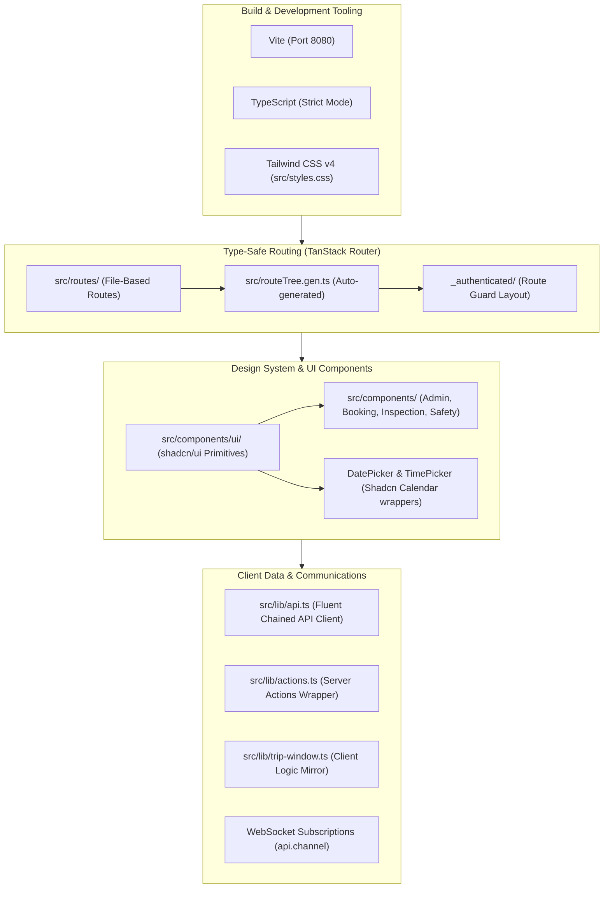

# Synchoo System Dossier — 06: Frontend Architecture, UI Changes & React Patterns

## 1. The 5-Year-Old Explanation: "The Magic Picture Book & Painting Canvas"

Imagine a magical picture book:
- **The Old Slow Way:** Every time you turn the page, the entire room goes black for 3 seconds, all the furniture is taken out and brought back in, and your eyes hurt (**Full Page Reloads**).
- **The Modern React Way (Single-Page App):** The picture book is alive! When you click on a toy car, only the picture of the car flips open smoothly. The header, the bottom navigation bar, and your glowing wristband never disappear or flicker!
- **The Light & Dark Magic Wand (Light-First UI Theme):** By default, the clubhouse is bright, clean, airy, and welcoming (clean white and crisp slate colors). But if you are reading under your bedsheets at night, you tap a little sun/moon button, and the entire app instantly turns dark charcoal with zero screen flash!
- **The Modular Toy Blocks (shadcn/ui & Tailwind v4):** Rather than drawing every button and calendar from scratch, we have a box of precision-crafted Lego bricks: date pickers, pop-up dialogs, slider bars, and toast notification alerts that snap together perfectly.

---

## 2. Modern Frontend Stack

Synchoo's frontend lives in `frontend/` and is built on modern React 19 standards:



---

## 3. UI Changes & Design Modernization (Gap Fixes Status)

Based on recent engineering sprints (see `partialfixes.md`), the UI was heavily upgraded:

| UI Area | What Changed | Component & Route |
|---|---|---|
| **Theme Default** | Switched to clean light-first aesthetic (`rs-theme \|\| 'light'`) with seamless dark-mode toggle. | `src/routes/__root.tsx`, `index.html` |
| **Home Search Switcher** | Segmented switcher for Vehicle Rental, Hire Driver, and Doorstep Wash with Shadcn date & time pickers. | `src/routes/index.tsx` |
| **Shadcn Date/Time Pickers** | Replaced browser native inputs with beautiful, accessible `DatePicker` and `TimePicker` wrapping Shadcn `Calendar`. | `src/components/date-picker.tsx`, `src/components/time-picker.tsx` |
| **Wash Pipeline Stepper** | Visual interactive pipeline stepper: `Requested` → `Confirmed` → `Cleaner assigned` → `On the way` → `Started` → `Completed`. | `src/routes/_authenticated/washes.tsx` |
| **360° Inspection Uploader** | 9-angle walk-around inspection photo uploader with camera capture, fuel/odometer inputs, and handover code verification. | `src/components/inspection-sheet.tsx`, `src/lib/actions.ts` |
| **Safety & Emergency SOS** | Trip Safety Center with live GPS coordinates, SOS alert trigger, accident reports, and trusted contacts. | `src/routes/safety.tsx`, `src/components/trip-safety-extension.tsx` |
| **Driver & Cleaner Hubs** | Dedicated operational dashboards with live earnings stats, upcoming confirmed jobs, and trip history. | `_authenticated/driver-dashboard.tsx`, `_authenticated/cleaner-dashboard.tsx` |

---

## 4. File-Based Routing with TanStack Router

Routing in Synchoo is 100% file-based inside `frontend/src/routes/`.

### 4.1 Route Guard Pattern (`_authenticated`)
Any route placed inside the `src/routes/_authenticated/` directory automatically requires a valid signed-in user session.

Look at `src/routes/_authenticated.tsx`:
```typescript
import { createFileRoute, redirect, Outlet } from "@tanstack/react-router";
import { api } from "@/lib/api";

export const Route = createFileRoute("/_authenticated")({
  beforeLoad: async ({ location }) => {
    const user = api.auth.getUser();
    if (!user) {
      // Redirect to login while preserving target redirect URL
      throw redirect({
        to: "/auth",
        search: { redirect: location.href },
      });
    }
  },
  component: () => <Outlet />,
});
```

### 4.2 Route Parameter Handling
Route parameters (like `/vehicle/$id`) are strongly typed:
```typescript
import { createFileRoute } from "@tanstack/react-router";

export const Route = createFileRoute("/vehicle/$id")({
  component: VehicleDetailPage,
});

function VehicleDetailPage() {
  const { id } = Route.useParams(); // Fully typed string!
  ...
}
```

---

## 5. Connecting UI to Backend: The `api.ts` Pattern

The frontend talks to the backend exclusively through `src/lib/api.ts`.
Key design principle: **Methods return `{ data, error }` instead of throwing exceptions.**

### Example: Fetching Vehicle with Reviews
```typescript
import { useEffect, useState } from "react";
import { api } from "@/lib/api";

export function useVehicleDetails(vehicleId: string) {
  const [vehicle, setVehicle] = useState<any>(null);
  const [loading, setLoading] = useState(true);

  useEffect(() => {
    async function load() {
      setLoading(true);
      const { data, error } = await api
        .from("vehicles")
        .select(`
          id, title, brand, model, price_per_day, city,
          images:vehicle_images(image_url),
          vendor:vendors(id, business_name, rating),
          reviews:reviews(id, rating, comment, user_name, created_at)
        `)
        .eq("id", vehicleId)
        .maybeSingle();

      if (!error && data) {
        setVehicle(data);
      }
      setLoading(false);
    }
    load();
  }, [vehicleId]);

  return { vehicle, loading };
}
```

---

## 6. How to Build & Modify UI (Developer Recipes)

### Recipe 1: Adding a New Page
1. Create a new file in `frontend/src/routes/`, e.g., `src/routes/faq.tsx`.
2. Define the route using `createFileRoute`:
   ```typescript
   import { createFileRoute } from "@tanstack/react-router";

   export const Route = createFileRoute("/faq")({
     component: FAQPage,
   });

   function FAQPage() {
     return (
       <div className="container mx-auto py-8">
         <h1 className="text-3xl font-bold mb-4">Frequently Asked Questions</h1>
         <p>Find answers to common questions about Synchoo rentals and pooling.</p>
       </div>
     );
   }
   ```
3. Vite will automatically regenerate `src/routeTree.gen.ts`. You do not need to register the route manually!

### Recipe 2: Submitting a Mutation with Toast Feedback
```typescript
import { useState } from "react";
import { api } from "@/lib/api";
import { Button } from "@/components/ui/button";
import { toast } from "sonner";

export function SubmitReportButton({ bookingId }: { bookingId: string }) {
  const [submitting, setSubmitting] = useState(false);

  const handleReport = async () => {
    setSubmitting(true);
    const { error } = await api.from("user_reports").insert({
      booking_id: bookingId,
      reason: "Vehicle was not cleaned before pickup",
      category: "cleanliness",
    });

    setSubmitting(false);
    if (error) {
      toast.error(error.message || "Could not submit report");
    } else {
      toast.success("Report submitted to our trust & safety team");
    }
  };

  return (
    <Button variant="destructive" disabled={submitting} onClick={handleReport}>
      {submitting ? "Submitting..." : "Report Issue"}
    </Button>
  );
}
```
