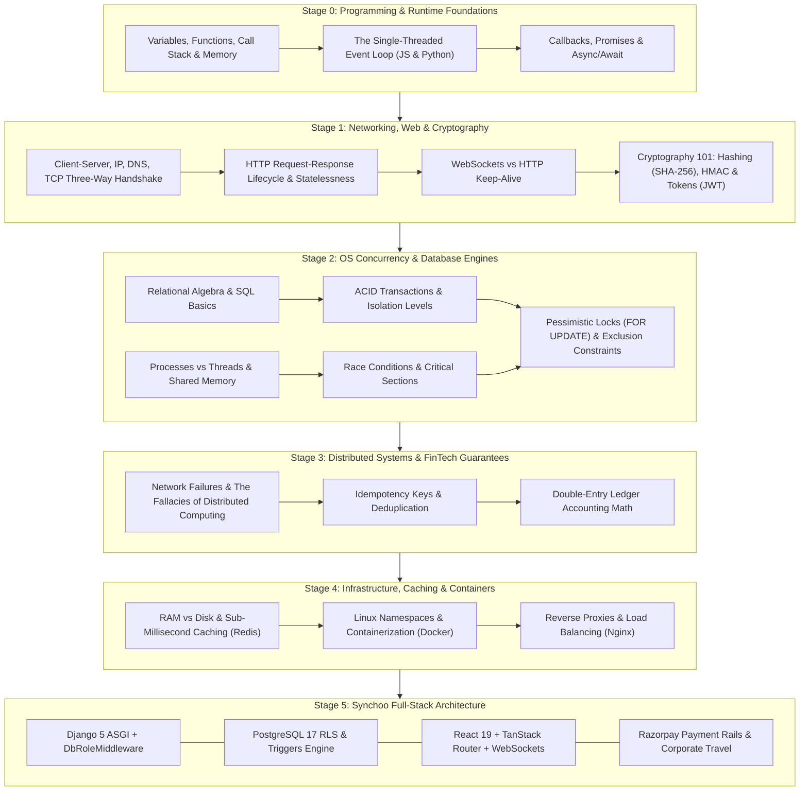

# Master Computer Science & Web Engineering Roadmap

> **Your Complete Learning Journey: From Ground-Zero CS Basics to Synchoo Full-Stack Architect**

If you try to learn concepts like *"Database Row Locking"*, *"Asynchronous WebSockets"*, or *"Payment Idempotency"* without understanding **how computers run code, how the internet moves packets, or how memory works**, it feels overwhelming and abstract.

This roadmap starts from the **absolute core fundamentals of Computer Science** (JavaScript/Python basics, how the Event Loop executes, how networking works) and connects each concept step-by-step directly to **Synchoo's production codebase**.

---

## 🗺️ The 6 Foundational Stages

---

## 📚 Curriculum Index & Guide Files

| Stage | Document | Core Questions Answered |
|---|---|---|
| **Stage 0** | [01-cs-foundations-programming-and-runtimes.md](01-cs-foundations-programming-and-runtimes.md) | How does a computer run code? What is the Call Stack? What is the Event Loop? Why do we need `async/await`? |
| **Stage 1** | [02-cs-networking-and-web-protocols.md](02-cs-networking-and-web-protocols.md) | What happens when you type a URL? How does TCP work? What is HTTP? How do WebSockets stay open? What is HMAC? |
| **Stage 2** | [03-cs-databases-concurrency-and-acid.md](03-cs-databases-concurrency-and-acid.md) | What are threads and processes? Why do race conditions break apps? What are ACID transactions, row locks, and isolation levels? |
| **Stage 3** | [04-distributed-systems-idempotency-and-payments.md](04-distributed-systems-idempotency-and-payments.md) | Why do networks drop requests? How does an Idempotency Key stop double charges? How does a double-entry ledger work? |
| **Stage 4** | [05-operating-systems-containers-and-caching.md](05-operating-systems-containers-and-caching.md) | What is a Docker container? Why is RAM faster than SSD? How does Redis pub/sub work? What does an Nginx load balancer do? |
| **Stage 5** | [06-from-cs-foundations-to-synchoo-codebase.md](06-from-cs-foundations-to-synchoo-codebase.md) | **The Master Capstone:** How every single fundamental above connects directly to Synchoo's files and lines of code. |

---

## 🎯 How to Follow This Roadmap

1. **Don't skip the basics:** If you don't know what a *Call Stack* is, `async/await` will feel like magic. Read Stage 0 first.
2. **Read the "Intuitive Analogy":** Every chapter starts with a real-world physical analogy before diving into computer science theory.
3. **Run the Code Snippets:** Open your browser console or terminal and run the simple 5-line examples.
4. **Follow the Synchoo Bridges:** At the end of every chapter, look at the exact file in Synchoo where that concept is used in production.
