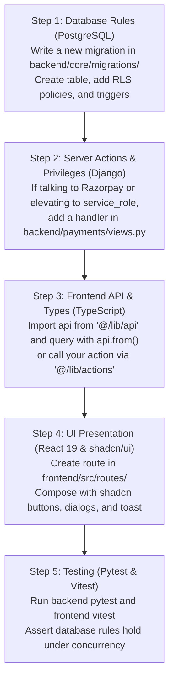

# Stage 5: The Grand Capstone (Connecting CS Foundations to Synchoo Code)

This is the master translation index. Every abstract computer science principle you have learned is mapped directly to the **exact files and lines of code** in the Synchoo repository.

---

## 🗺️ The Master Computer Science to Synchoo Mapping Table

| Computer Science Concept | What It Does Conceptually | Exact Synchoo File | Key Function / Code Location |
|---|---|---|---|
| **1. Asynchronous Event Loop** | Non-blocking I/O, event-driven execution | [`backend/realtime/consumers.py`](file:///C:/Users/gclik/Desktop/Projects/Stalight%20Technologies/stalightride/backend/realtime/consumers.py) | `async def connect()`, `async def receive()` |
| **2. Stateless JWT Authentication** | Cryptographic bearer tokens verified without DB lookup | [`backend/core/auth.py`](file:///C:/Users/gclik/Desktop/Projects/Stalight%20Technologies/stalightride/backend/core/auth.py) | `class JWTRoleAuthentication` |
| **3. Atomic Transactions (ACID)** | Wrap request in all-or-nothing rollback block | [`backend/core/middleware.py`](file:///C:/Users/gclik/Desktop/Projects/Stalight%20Technologies/stalightride/backend/core/middleware.py) | `with transaction.atomic(): set_db_role("anon")` |
| **4. Cryptographic HMAC Hashing** | Constant-time tamper-proof payment verification | [`backend/payments/views.py`](file:///C:/Users/gclik/Desktop/Projects/Stalight%20Technologies/stalightride/backend/payments/views.py) | `_check_signature()`, `hmac.compare_digest()` |
| **5. Database Row-Level Security** | Storage-engine-level data isolation based on `auth.uid()` | [`backend/sql/schema.sql`](file:///C:/Users/gclik/Desktop/Projects/Stalight%20Technologies/stalightride/backend/sql/schema.sql) | `CREATE POLICY "Parties view booking" ON public.bookings` |
| **6. Pessimistic Row Locking** | Exclusive lock (`FOR UPDATE`) preventing race conditions | [`backend/payments/views.py`](file:///C:/Users/gclik/Desktop/Projects/Stalight%20Technologies/stalightride/backend/payments/views.py) | `verify_wallet_topup()` (`WHERE razorpay_order_id = %s FOR UPDATE`) |
| **7. Exclusion Constraints (GiST)** | Mathematical prevention of overlapping date ranges | [`backend/core/migrations/0020_...`](file:///C:/Users/gclik/Desktop/Projects/Stalight%20Technologies/stalightride/backend/core/migrations/0020_remediate_components_01_to_04_gaps.py) | `ADD CONSTRAINT bookings_no_overlap EXCLUDE USING gist (...)` |
| **8. Double-Entry Accounting Ledger** | Append-only financial tracking with non-negative invariant | [`backend/sql/schema.sql`](file:///C:/Users/gclik/Desktop/Projects/Stalight%20Technologies/stalightride/backend/sql/schema.sql) | `public.wallet_apply()`, `wallet_transactions` table |
| **9. Idempotency Key Pattern** | Deduplicating webhook retries and double-clicks | [`backend/payments/views.py`](file:///C:/Users/gclik/Desktop/Projects/Stalight%20Technologies/stalightride/backend/payments/views.py) | `if status == "paid": return {"ok": True, "alreadyCredited": True}` |
| **10. Declarative Query Compilation** | Translating client JSON chains into catalog-checked SQL | [`backend/core/query.py`](file:///C:/Users/gclik/Desktop/Projects/Stalight%20Technologies/stalightride/backend/core/query.py) | `def run(spec)` & catalog identifier validation |
| **11. Persistent WebSockets (Full Duplex)** | Real-time push updates via persistent TCP sockets | [`backend/config/asgi.py`](file:///C:/Users/gclik/Desktop/Projects/Stalight%20Technologies/stalightride/backend/config/asgi.py) | `ProtocolTypeRouter({"http": ..., "websocket": ...})` |
| **12. Multi-Container Orchestration** | Isolated network, volumes, and service discovery | [`docker-compose.yml`](file:///C:/Users/gclik/Desktop/Projects/Stalight%20Technologies/stalightride/docker-compose.yml) | `services: [db, redis, backend, cron, frontend]` |

---

## 🛠️ The Full-Stack Developer Workflow: How to Build a Feature

When you are asked to add a new feature to Synchoo (for example, *"Add a VIP Membership Loyalty Discount"*), follow this exact mental checklist:

---

## 🎓 You Are Now Ready!

By completing this curriculum, you have bridged the gap from fundamental computer science theory to the real-world production architecture of Synchoo.

You are now in a position to:
1. Explain the architectural decisions to any principal engineer, founder, or investor.
2. Read any file in `backend/`, `frontend/`, or `backend/sql/` without feeling lost.
3. Write clean, race-condition-free, idempotent code that respects financial and data consistency.
